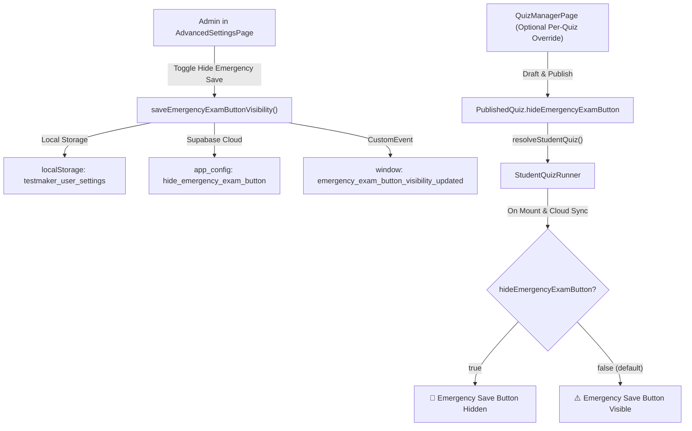

# Plan: Add Option to Hide Emergency Exam Button in Admin Settings

## 1. Objective
Add a dedicated administrator toggle in the **Admin Settings** (`AdvancedSettingsPage`) under **Exam Security & Feature Controls** that allows teachers and administrators to hide the "⚠️ Emergency Save" button in the candidate exam interface (`StudentQuizRunner`).

---

## 2. Architecture & Data Flow

---

## 3. Implementation Steps

1. **`src/lib/settings.ts`**:
   - Add `hideEmergencyExamButton?: boolean` to `AppSettings`.
   - Set default: `hideEmergencyExamButton: false` in `DEFAULT_SETTINGS`.
   - Implement `saveEmergencyExamButtonVisibility(hide: boolean)`.
   - Implement `syncEmergencyExamButtonVisibilityToCloud(hide: boolean)`.
   - Implement `loadAndSyncEmergencyExamButtonVisibility(): Promise<boolean>`.
   - Implement `getEmergencyExamButtonHidden(): boolean`.

2. **`src/pages/AdvancedSettingsPage.tsx`**:
   - Import `saveEmergencyExamButtonVisibility` and `loadAndSyncEmergencyExamButtonVisibility`.
   - Add `handleToggleHideEmergencyExamButton(hide: boolean)` handler.
   - Sync on mount during `useEffect`.
   - Add setting card in `🛡️ Exam Security & Feature Controls` section:
     - Title: `⚠️ Hide Emergency Save Button (Exam Runner)`
     - Description: "Hides the '⚠️ Emergency Save' button in the candidate exam interface. When hidden, students cannot self-initiate emergency offline hand-in, preventing unauthorized early exits or distractions."
     - Toggle: `Hidden (Active)` vs `Visible (Default)`.

3. **`src/services/quizManagerService.ts` & `src/services/quizCodeService.ts`**:
   - Add `hideEmergencyExamButton?: boolean` to `PublishedQuiz` and `StudentQuizData`.
   - Inherit default from `getSavedSettings().hideEmergencyExamButton` when creating/publishing a quiz.

4. **`src/pages/QuizManagerPage.tsx`**:
   - Add per-quiz switch inside the security settings card so teachers can also override it per exam.

5. **`src/pages/StudentQuizRunner.tsx`**:
   - Initialize state `hideEmergencyExamButton` from `savedExam?.hideEmergencyExamButton ?? getSavedSettings().hideEmergencyExamButton ?? false`.
   - Populate from `data.hideEmergencyExamButton` in `resolveStudentQuiz`.
   - Persist in session snapshot `buildExamStateSnapshot`.
   - Wrap the `<button className="sq-btn sq-btn-emergency-exit">` with `{!hideEmergencyExamButton && ...}`.
   - Also guard modal display `{!hideEmergencyExamButton && showEmergencyExitModal && ...}`.

6. **Verification & Tests**:
   - Create automated test script `scripts/test-hide-emergency-button-setting.mjs`.
   - Verify all test suites pass.
   - Verify `npm run build` passes with zero errors.

