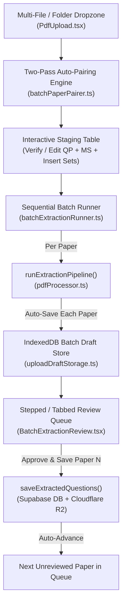

# Architectural Blueprint & Implementation Plan: Smart Batch Past Paper Upload (`Plan/batch_upload.md`)

> **Status:** Draft Proposal (Ready for User Review)  
> **Created:** 2026-11-06  
> **Target Version:** v.2.4.0  
> **Design System:** ICM Exam Platform (`ENERGY 2 / RHYTHM 2 / MOTION 1`)

---

## 1. Motivation & Problem Statement

Currently, [`UploadPage.tsx`](file:///c:/testmaker/src/pages/UploadPage.tsx) and [`PdfUpload.tsx`](file:///c:/testmaker/src/components/PdfUpload.tsx) only support staging **one paper at a time** (1 Question Paper + 1 optional Mark Scheme + 1 optional Insert Booklet).

When ingesting an entire subject folder—such as [`sociology/`](file:///c:/testmaker/sociology) (24 PDFs = 12 papers), [`economics paper/`](file:///c:/testmaker/economics%20paper) (20 PDFs = 9 papers), or [`geography paper/`](file:///c:/testmaker/geography%20paper) (6 PDFs = 2 papers with inserts)—teachers must manually:
1. Drag and match the Question Paper, Mark Scheme, and Insert for a single paper.
2. Wait 25–60 seconds for extraction.
3. Review and click Save.
4. Click "Upload Another Paper" and repeat the process 10–20 times.

### Core Design Decisions (Aligned with User Requirements)
1. **Smart Auto-Pairing Dropzone**: Teachers drop a folder or multiple PDFs at once. The system inspects both filenames and PDF cover pages to classify each document (`QP`, `MS`, `Insert`) and group them into editable paper sets.
2. **Smart Sequential Extraction Queue**: Papers are extracted sequentially (1 paper at a time), preserving full multi-key chunk parallelism *within* each paper while isolating errors so a single failed PDF never halts the batch.
3. **Tabbed / Stepped Review Queue**: Extracted papers enter a persistent review queue where each paper is inspected and manually approved via [`ExtractionReview`](file:///c:/testmaker/src/components/ExtractionReview.tsx) before saving to the Question Bank and Cloudflare R2.

---

## 2. Technical Architecture & Data Structures



### 2.1 Core Types (`src/lib/batchPaperPairer.ts`)

```typescript
export type DocumentRole = 'qp' | 'ms' | 'insert' | 'unknown';

export interface ClassifiedPdfFile {
  file: File;
  role: DocumentRole;
  syllabusCode: string;       // e.g. "0455", "9696", "0495", "0620"
  subjectName: string;        // e.g. "Economics", "Geography"
  domain: SubjectDomain;      // 'stem' | 'humanities' | 'languages'
  year: number | null;        // e.g. 2024
  series: string;             // Canonical: 'May/June' | 'October/November' | 'February/March' | ''
  paperCode: string;          // e.g. "22", "12", "11"
  duplicateSuffix?: number;   // e.g. 2 from "(2).pdf"
  groupKey: string;           // "${syllabusCode}_${year}_${series}_${paperCode}"
}

export interface StagedPaperSet {
  id: string;                 // Unique UUID or deterministic groupKey
  groupKey: string;
  label: string;              // e.g. "Economics (0455/22) • May/June 2024"
  syllabusCode: string;
  subjectName: string;
  domain: SubjectDomain;
  year: number | null;
  series: string;
  paperCode: string;
  qpFile: File | null;
  msFile: File | null;
  insertFile: File | null;
  warnings: string[];         // e.g. ["Missing Mark Scheme", "Insert recommended for 9696/11"]
}

export interface PairingResult {
  paperSets: StagedPaperSet[];
  unassignedFiles: {
    file: File;
    detectedRole: DocumentRole;
    reason: string;           // e.g. "Duplicate Mark Scheme (already paired)" or "Orphan MS without matching QP"
  }[];
}
```

---

### 2.2 Two-Pass Deterministic Auto-Pairing Engine (`src/lib/batchPaperPairer.ts`)

Real-world past paper folders use three distinct naming conventions (all present in our workspace):
1. **Standard Cambridge Short Code** (`sociology/`): `0495_s25_qp_11.pdf`, `0495_s25_ms_11.pdf`
2. **Verbose Descriptive Naming with Duplicate Suffixes** (`economics paper/`): `0455 Economics June 2025 Question Paper  12 (2).pdf`, `0455 Economics June 2025 Mark Scheme  12 (4).pdf`
3. **Syllabus-Omitted Naming** (`geography paper/`): `paper1_question paper_11_june25.pdf`, `paper1_mark scheme_11_june25.pdf`, `paper1_insert_11_june25.pdf` (where `9696` only appears inside the PDF cover page)

To handle all three with 100% accuracy:

#### Pass 1: Filename Token Extraction
- Strip OS download duplicate suffixes `\(\d+\)(?=\.pdf$)` while recording `duplicateSuffix` so clean originals are preferred over `(2)` / `(4)` duplicates.
- Extract role keywords:
  - `qp`: `\b(qp|question\s*paper)\b`
  - `ms`: `\b(ms|mark\s*scheme)\b`
  - `insert`: `\b(in|ins|insert|resource\s*booklet|sf)\b`
- Extract season/series (`s25` $\rightarrow$ `May/June 2025`, `w24` $\rightarrow$ `October/November 2024`, `m23` $\rightarrow$ `February/March 2023`, or full month names `June 2024`, `june25`, `nov24`).
- Extract 4-digit syllabus code (`0455`, `0495`, `0620`, `9696`) and 2-digit paper/variant code (`11`, `12`, `22`, `53`).

#### Pass 2: Cover-Page Inspection (`readPdfTextLayout(bytes, 2)` + `classifySubject`)
- Reads the first 2 pages of each dropped PDF (fast, ~15ms per file in `pdfjs-dist`).
- Calls [`classifySubject(pageTexts, { fileName })`](file:///c:/testmaker/src/lib/subjectClassifier.ts) to resolve syllabus code, subject name, and `domain` (`stem`, `humanities`, `languages`) even when the filename lacks a syllabus code (e.g. `paper1_question paper_11_june25.pdf` $\rightarrow$ `9696/11`).
- Detects document role from cover text if filename role is ambiguous:
  - `/Published\s+Mark\s+Scheme|Generic\s+Marking\s+Principles|MARK\s+SCHEME/i` $\rightarrow$ `'ms'`
  - `/\bINSERT\b[\s\S]{0,120}(?:contains|Fig\.|Photograph)/i` $\rightarrow$ `'insert'`
  - `/INSTRUCTIONS[\s\S]{0,200}Answer\s+(?:all|four|three|one)\s+question/i` $\rightarrow$ `'qp'`
- Falls back to Pass 1 filename metadata whenever a PDF has Caesar-shifted font encoding on Page 1 (e.g. `0455 Economics March 2023 Question paper  12.pdf`).

#### Grouping & Conflict Resolution
- Groups files by `groupKey = "${syllabusCode}_${year}_${series}_${paperCode}"`.
- If a group has a `qpFile`, it forms a valid `StagedPaperSet`.
- If multiple files compete for the same slot in a group (e.g. `0455 Economics June 2026 Mark Scheme  12 (2).pdf` and `(3).pdf`), the file with the lowest `duplicateSuffix` is slotted into `msFile` and the extra copy is placed in `unassignedFiles` with reason `"Duplicate Mark Scheme for 0455/12 June 2026"`.
- If an `msFile` or `insertFile` has no matching `qpFile` in the batch, it is placed in `unassignedFiles` so the teacher can either drag it into an existing row, add its missing QP, or ignore it.

---

### 2.3 Batch Queue & Draft Persistence (`src/lib/uploadDraftStorage.ts`)

Currently, `uploadDraftStorage.ts` stores a single record under `DRAFT_KEY = 'active_upload_draft'`. Extracting 10 papers takes ~3–5 minutes; if the browser tab is refreshed or closed during extraction or halfway through reviewing, zero work should be lost.

#### Schema Upgrade (`DB_VERSION = 2`)
Add a second object store `batch_upload_drafts` keyed by `itemId`:

```typescript
export type BatchItemStatus =
  | 'queued'
  | 'extracting'
  | 'ready'       // Extracted and waiting for teacher review in Queue
  | 'saving'      // Currently uploading to Supabase / Cloudflare R2
  | 'saved'       // Approved & saved to Question Bank
  | 'error';      // Extraction failed

export interface RawBatchDraftItem {
  itemId: string;               // Matches StagedPaperSet.id
  batchId: string;
  orderIndex: number;
  label: string;
  status: BatchItemStatus;
  error?: string | null;
  domain: SubjectDomain;
  includeGuidance: boolean;
  isIgcse: boolean;
  isSaveMyExams?: boolean;
  tags?: string;
  timestamp: number;
  // Original staged blobs (so queued/errored items can be run or retried after refresh)
  qpBlob: Blob | null;
  qpName: string | null;
  msBlob: Blob | null;
  msName: string | null;
  insertBlob: Blob | null;
  insertName: string | null;
  // Populated once status === 'ready'
  result?: ExtractionResult | null;
  diagrams?: StoredDiagramItem[];
  savedQuestionCount?: number;
  savedQuestionIds?: string[];
}
```

#### Recovery Capabilities
- If the teacher refreshes while 6 of 10 papers are `'ready'` and 4 are `'queued'`, the Draft Recovery Banner on `UploadPage.tsx` displays:
  > **Unsaved Batch Extraction Found** — 6 papers ready for review, 4 queued (`Resume Batch Review` / `Discard Batch`).
- Once a paper is approved and saved in `BatchExtractionReview`, its status updates to `'saved'` and its heavy PDF/diagram blobs are cleared from IndexedDB to free disk space. When all items in the batch are `'saved'`, the batch draft is purged automatically.

---

## 3. Step-by-Step UI & Component Architecture

### 3.1 Mode Switch & Batch Staging UI in [`src/components/PdfUpload.tsx`](file:///c:/testmaker/src/components/PdfUpload.tsx)

1. **Top Mode Switcher (Flat Underline Tabs per `DESIGN.md`)**:
   - `Single Paper` (existing 3-slot layout, untouched)
   - `Batch Upload (Multi-Paper / Folder)`
2. **Batch Dropzone**:
   - Accepts multiple PDFs (`multiple` attribute on `<input type="file" accept="application/pdf" multiple />`) and folder drops (traversing `DataTransferItem.webkitGetAsEntry()` recursively to collect `.pdf` files inside dropped folders).
   - Also provides a secondary button `"Select Folder…"` using `webkitdirectory`.
3. **Interactive Paper Set Staging Table**:
   - Once files are dropped, shows a clean institutional table:
     - **Column 1: Paper Identity & Domain** — Auto-detected badge (e.g. `Economics 0455/22 • May/June 2024`) + compact domain pill (`Humanities` / `STEM` / `Languages`, clickable to override per paper).
     - **Column 2: Question Paper (Required)** — File pill with remove/replace action.
     - **Column 3: Mark Scheme (Optional)** — File pill (`✓ Attached` or `+ Drop / Select MS`).
     - **Column 4: Resource Insert (Optional)** — File pill (`✓ Attached`, `Recommended` warning badge if `profile.hasInsertByDefault` is true and missing, or `+ Attach`).
     - **Column 5: Row Actions** — Remove paper set from batch.
   - **Unassigned / Duplicates Tray (Collapsible)**:
     - Lists any duplicate files or unmatched Mark Schemes/Inserts with a dropdown to `"Assign to Paper Set…"` or `"Dismiss"`.
   - **Primary CTA**:
     - `"Extract N Papers Sequentially"` (disabled if 0 valid QP sets).

---

### 3.2 Sequential Extraction Runner & Live Cockpit (`src/components/BatchPipelineProgress.tsx`)

When the teacher clicks `"Extract N Papers Sequentially"`:
1. **Sequential Execution Loop**:
   - Iterates through staged paper sets `0 .. N-1`.
   - For each paper set:
     - Sets item status to `'extracting'`.
     - Calls [`runExtractionPipeline(qpFile, msFile, insertFile, onStageChange, itemOptions)`](file:///c:/testmaker/src/lib/pdfProcessor.ts#L676).
     - Notice that each paper set uses its **own** auto-detected `domain` (`stem` / `humanities` / `languages`), so a teacher can even batch-upload a mix of Economics, Geography, and Chemistry papers in one run.
     - On success: saves `result` and `diagramData` to IndexedDB (`status: 'ready'`).
     - On error: retries once after a 3s backoff; if still failing, records `status: 'error'` with the error message and immediately proceeds to the next paper set.
2. **Live Progress View**:
   - **Batch Summary Bar**: Shows `"Extracting Paper 3 of 9 (0455/22 May/June 2024) • 2 Ready for Review • 0 Failed"` with an overall batch progress bar.
   - **Active Paper Pipeline**: Embeds [`PipelineProgress`](file:///c:/testmaker/src/components/PipelineProgress.tsx) for the currently running paper.
   - **Paper Queue Checklist**: Compact list showing each paper's status (`✓ Ready (30 Qs)`, `● Extracting…`, `○ Queued`, `✕ Failed`).
   - **Early Review Entry**: As soon as at least 1 paper reaches `'ready'`, a button **"Start Reviewing Ready Papers (N) →"** appears so the teacher can begin reviewing Paper 1 while Paper 2..N continue extracting in the background, OR wait until all papers finish and automatically transition to the Review Queue.

---

### 3.3 Tabbed / Stepped Review Queue (`src/components/BatchExtractionReview.tsx`)

Once papers are extracted, `UploadPage.tsx` renders `BatchExtractionReview`:

1. **Sticky Batch Queue Navigation Bar (Top)**:
   - Displays all papers in the batch as interactive step tabs:
     - `[✓ 1. 0455/22 Jun 2024 (Saved • 5 Qs)]`
     - `[● 2. 0455/12 Jun 2023 (Reviewing • 30 Qs)]` *(Active)*
     - `[○ 3. 0455/22 Mar 2025 (Pending Review • 5 Qs)]`
     - `[! 4. 0455/12 Mar 2023 (Failed — Click to Retry)]`
   - Shows queue counter: `"Reviewed 1 of 4 Papers • 35 Total Questions Ingested"`.
   - Provides `"Skip / Discard Current Paper"` and `"Cancel Entire Batch"` secondary actions.
2. **Full `ExtractionReview` Workspace (Body)**:
   - Renders the existing [`ExtractionReview`](file:///c:/testmaker/src/components/ExtractionReview.tsx) component keyed by `activeItem.id` (`<ExtractionReview key={activeItem.id} ... />`).
   - All existing teacher tools work identically per paper:
     - Inline Fast-Edit mode & Question Editor Modal
     - Interactive PDF Diagram Snip & Crop Modal (`qpFile` & `insertFile`)
     - Resource Booklet Drawer (`insert_resources`)
     - Duplicate question detection & Mark tally verification
3. **Approve & Auto-Advance Flow**:
   - When the teacher clicks **"Confirm & Save Questions"** inside `ExtractionReview`:
     - Calls `saveExtractedQuestions(...)` for the active paper (uploading diagrams + source QP PDF + Insert PDF to Cloudflare R2 / Supabase).
     - Marks the active paper tab as `saved` (`✓ Saved`).
     - Automatically switches the active tab to the **next `'ready'` (unreviewed) paper** in the queue.
   - When the final paper in the queue is saved, transitions to the **Batch Complete Summary Screen** showing total papers and questions saved, with actions to `"Assemble Test with Extracted Questions"` or `"Upload Another Batch"`.

---

## 4. Files to Create & Modify

| File | Action | Responsibility |
| :--- | :--- | :--- |
| [`src/lib/batchPaperPairer.ts`](file:///c:/testmaker/src/lib/batchPaperPairer.ts) | **NEW** | Two-pass filename + PDF cover layout classifier and deterministic `(QP, MS, Insert)` paper-set grouper; recursive folder drop reader. |
| [`src/components/BatchExtractionReview.tsx`](file:///c:/testmaker/src/components/BatchExtractionReview.tsx) | **NEW** | Sticky batch queue tab bar, status pills, retry handler for failed items, and wrapper around `ExtractionReview` with auto-advance on save. |
| [`src/components/PdfUpload.tsx`](file:///c:/testmaker/src/components/PdfUpload.tsx) | **MODIFY** | Add `Single Paper` / `Batch Upload` underline tab toggle, multi-file/folder dropzone, interactive paper-set staging table, and unassigned/duplicate file tray. |
| [`src/components/PdfUpload.css`](file:///c:/testmaker/src/components/PdfUpload.css) | **MODIFY** | Styles for the mode tabs, batch staging table, slot pills, and unassigned file tray following `DESIGN.md` tokens. |
| [`src/lib/uploadDraftStorage.ts`](file:///c:/testmaker/src/lib/uploadDraftStorage.ts) | **MODIFY** | Upgrade IndexedDB to `DB_VERSION = 2` with `batch_upload_drafts` store for per-paper incremental persistence and crash recovery. |
| [`src/pages/UploadPage.tsx`](file:///c:/testmaker/src/pages/UploadPage.tsx) | **MODIFY** | Add batch queue state orchestration, sequential extraction loop (with background continuation while reviewing), and batch completion summary. |
| [`scripts/verify-batch-pairer.mjs`](file:///c:/testmaker/scripts/verify-batch-pairer.mjs) | **NEW** | Automated verification harness testing `batchPaperPairer.ts` against all 50 PDFs across `sociology/`, `geography paper/`, and `economics paper/`. |

---

## 5. Verification & Testing Strategy

1. **Automated Multi-Folder Pairing Test (`scripts/verify-batch-pairer.mjs`)**:
   - Feed all 50 PDF files from `sociology/` (24 files), `geography paper/` (6 files), and `economics paper/` (20 files) simultaneously into `pairBatchPdfFiles()`.
   - Verify:
     - **Sociology (`0495`)**: 24 files $\rightarrow$ **12 Paper Sets**, each with 1 QP + 1 MS (`domain: 'humanities'`).
     - **AS Geography (`9696`)**: 6 files $\rightarrow$ **2 Paper Sets** (`9696/11` June 2025 & `9696/13` Nov 2024), each with 1 QP + 1 MS + 1 Insert (`domain: 'humanities'`).
     - **Economics (`0455`)**: 20 files $\rightarrow$ **9 Paper Sets** (4 Paper 22 sets + 5 Paper 12 sets) with 1 QP + 1 MS each, plus 2 extra Mark Scheme files (`June 2026 MS 12 (3).pdf` and `March 2026 MS 22.pdf` which has no matching QP) cleanly isolated into `unassignedFiles`.
2. **Sequential Queue & Error Isolation Verification**:
   - Verify that if one paper in a batch throws an extraction error, the batch marks that paper as `error` (with a working `Retry` button) and continues extracting the remaining papers.
3. **IndexedDB Crash Recovery Verification**:
   - Verify that refreshing the page mid-batch or mid-review restores all extracted paper results, cropped diagram previews, and remaining queued files.
4. **TypeScript & Production Bundle Verification**:
   - Run `npm.cmd run build` (`tsc -b && vite build`) to confirm zero type or bundling regressions.

