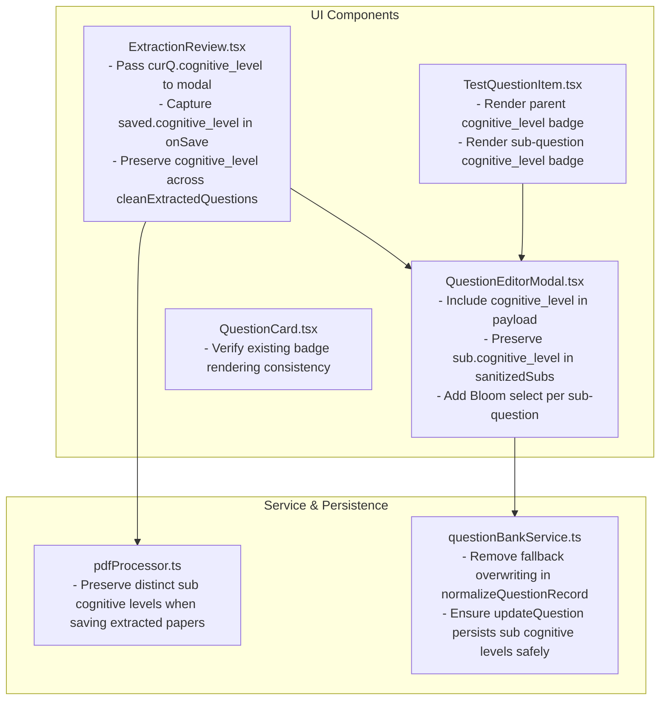

# Bloom's Taxonomy Parity & Sub-Question Independence Implementation Plan

## 1. Overview & Context

This plan addresses three confirmed issues regarding Bloom's Taxonomy (C1–C6) editing, persistence, and parity across the **Question Bank**, **Test Builder**, and **Extraction Review** (after paper upload).

### Confirmed Root Causes

1. **Bloom's Level Not Saved After Editing**:
   - In [`src/components/QuestionEditorModal.tsx`](file:///e:/VibeCoding/testmaker/src/components/QuestionEditorModal.tsx#L834-L857), `handleSave()` omitted `cognitive_level: cognitiveLevel || null` from the payload sent to `updateQuestion()`, `createQuestion()`, or the `onSave` callback.
   - In [`src/components/ExtractionReview.tsx`](file:///e:/VibeCoding/testmaker/src/components/ExtractionReview.tsx#L1334-L1383), the modal invocation omitted passing `cognitive_level` to `QuestionEditorModal`, and `onSave` did not capture `saved.cognitive_level` back into `updatedList[editingIdx]`.

2. **No UI or Field to Edit Sub-Question Bloom's Levels**:
   - In [`src/components/QuestionEditorModal.tsx`](file:///e:/VibeCoding/testmaker/src/components/QuestionEditorModal.tsx#L1528-L1590), the sub-question form card has inputs for `sub_id`, `marks`, `question_text`, `mark_scheme`, and `guidance`, but **no cognitive level selector**.

3. **Editing Main Question Overwrites All Sub-Questions**:
   - In [`src/components/QuestionEditorModal.tsx`](file:///e:/VibeCoding/testmaker/src/components/QuestionEditorModal.tsx#L265-L290), `sanitizedSubs` mapped incoming sub-questions but omitted `cognitive_level`, wiping it from memory.
   - When saved, `sub_questions` was persisted with `cognitive_level: undefined`.
   - In [`src/services/questionBankService.ts`](file:///e:/VibeCoding/testmaker/src/services/questionBankService.ts#L1179), `normalizeQuestionRecord` ran:
     ```ts
     cognitive_level: sub.cognitive_level || sub.mark_scheme?._cognitive_level || cognitiveLevel || null
     ```
     Because `sub.cognitive_level` was stripped to undefined, it fell back to `cognitiveLevel` (the parent question's level), cascading the parent's level onto every sub-question.

---

## 2. Aligned Design Decisions (Grill-Me Alignment)

| Design Aspect | Agreed Specification |
| :--- | :--- |
| **Parent vs. Sub-Question Relationship** | **Decoupled & Independent**: Each sub-question has its own Bloom's level (C1–C6 or Unassigned). The parent question has its own overall level. Modifying the parent question **never** alters sub-questions, and modifying sub-questions **never** alters the parent question. |
| **Extraction Review (Paper Upload) Flow** | **Modal Only for Sub-Questions**: The Extraction Review list keeps its clean layout with the inline dropdown for the parent question. Sub-question Bloom's levels are edited inside the full `QuestionEditorModal` when clicking "Edit", preventing table clutter. |
| **Test Builder Display Parity** | **Full Parity**: `TestQuestionItem` displays Bloom's badges (`[C1]`–`[C6]`) for both the parent question and each sub-question row, styled identically to `QuestionCard` in Question Bank. |

---

## 3. Scope of Changes



---

## 4. Implementation Steps

### Step 1: Fix Core Persistence & Sub-Question Editing in `QuestionEditorModal.tsx`
- **File**: [`src/components/QuestionEditorModal.tsx`](file:///e:/VibeCoding/testmaker/src/components/QuestionEditorModal.tsx)
- **Changes**:
  1. **Preserve Sub-Question Cognitive Level on Load**:
     In `sanitizedSubs` (lines 265–290), add:
     ```ts
     cognitive_level: (sub?.cognitive_level || sub?.mark_scheme?._cognitive_level || null) as CognitiveLevel | null,
     ```
  2. **Include Cognitive Level in Save Payload**:
     In `handleSave()` (lines 834–857), add:
     ```ts
     cognitive_level: (cognitiveLevel as CognitiveLevel) || null,
     ```
  3. **Add Bloom's Taxonomy Selector for Each Sub-Question**:
     In the Sub-Question Header section (lines 1530–1560):
     - Add a compact `<select>` for `sub.cognitive_level`:
       - Options: `Unassigned`, `C1 (Remembering)`, `C2 (Understanding)`, `C3 (Applying)`, `C4 (Analyzing)`, `C5 (Evaluating)`, `C6 (Creating)`.
       - Calls `handleUpdateSubQuestion(si, { cognitive_level: (e.target.value as CognitiveLevel) || null })`.
  4. Ensure `handleSave()` sends `finalSubQuestions` with every sub-question's `cognitive_level` intact.

---

### Step 2: Fix Extraction Review Flow in `ExtractionReview.tsx`
- **File**: [`src/components/ExtractionReview.tsx`](file:///e:/VibeCoding/testmaker/src/components/ExtractionReview.tsx)
- **Changes**:
  1. **Pass `cognitive_level` to `QuestionEditorModal`**:
     In lines 1334–1353, include:
     ```ts
     cognitive_level: curQ.cognitive_level || null,
     ```
  2. **Persist `cognitive_level` on Modal Save**:
     In lines 1371–1384 (`onSave`), include:
     ```ts
     cognitive_level: saved.cognitive_level || originalQ.cognitive_level || null,
     ```
  3. **Verify `cleanExtractedQuestions` and `handleSaveClick`**:
     Ensure `cognitive_level` on both questions and sub-questions is passed to `pdfProcessor.saveExtractedQuestions()`.

---

### Step 3: Decouple Sub-Question Cognitive Levels in Service Layer
- **File**: [`src/services/questionBankService.ts`](file:///e:/VibeCoding/testmaker/src/services/questionBankService.ts)
- **Changes**:
  1. **Normalize Sub-Questions Independently**:
     In `normalizeQuestionRecord()` (lines 1176–1183), update sub-question mapping:
     ```ts
     cognitive_level: sub.cognitive_level || sub.mark_scheme?._cognitive_level || null,
     ```
     *(Remove `|| cognitiveLevel` so parent's cognitive level never silently overrides sub-questions).*
  2. **Verify `updateQuestion` and Schema Resilience**:
     Ensure `updateQuestion` persists both the parent `cognitive_level` column / `mark_scheme._cognitive_level` and `sub_questions` JSONB containing each sub-part's `cognitive_level`.

---

### Step 4: Ensure PDF Extraction Ingestion Preserves Independent Levels
- **File**: [`src/lib/pdfProcessor.ts`](file:///e:/VibeCoding/testmaker/src/lib/pdfProcessor.ts)
- **Changes**:
  1. In `saveExtractedQuestions` (line 229), ensure sub-question cognitive levels are preserved:
     ```ts
     cognitive_level: sub.cognitive_level || null,
     ```
     *(Do not force fallback to `effectiveCognitiveLevel` if sub-question was deliberately left null or separate).*

---

### Step 5: Test Builder Parity in `TestQuestionItem.tsx`
- **File**: [`src/components/TestQuestionItem.tsx`](file:///e:/VibeCoding/testmaker/src/components/TestQuestionItem.tsx)
- **Changes**:
  1. **Parent Header Bloom's Badge**:
     Add the Bloom's badge next to difficulty in the question card header:
     ```tsx
     {question.cognitive_level && (
       <span
         className="q-badge"
         style={{
           background: '#eff6ff',
           color: '#1d4ed8',
           fontWeight: 600,
           border: '1px solid #bfdbfe',
         }}
         title={`Bloom's Taxonomy: ${question.cognitive_level}`}
       >
         {question.cognitive_level}
       </span>
     )}
     ```
  2. **Sub-Question Row Bloom's Badge**:
     In the sub-question row header (around line 345):
     ```tsx
     {sub.cognitive_level && (
       <span
         className="q-badge"
         style={{
           fontSize: '11px',
           fontWeight: 600,
           color: '#1d4ed8',
           backgroundColor: '#eff6ff',
           padding: '1px 6px',
           borderRadius: '4px',
           border: '1px solid #bfdbfe',
         }}
         title={`Bloom's Taxonomy: ${sub.cognitive_level}`}
       >
         {sub.cognitive_level}
       </span>
     )}
     ```

---

## 5. Verification & Testing Plan

1. **Automated Unit & Integration Tests**:
   - Run `npm run test:gestures` (ensure no regressions in security/interaction gestures).
   - Run `npm run test:gforms` (ensure no regressions in Google Forms export).
   - Run `npm run build` (verify TypeScript types and Vite bundle).

2. **Persistence & Independence Verification**:
   - Create a test script verifying that:
     1. Saving a question with parent level `C4` and sub-questions with levels `C1`, `C2`, `C3` persists all distinct levels.
     2. Editing the parent question to `C5` does **not** modify sub-questions (`C1`, `C2`, `C3` remain unchanged).
     3. Editing a sub-question to `C6` does **not** modify parent question (`C5` remains unchanged).
     4. Creating a question in Question Bank, Test Builder, and Extraction Review correctly sets and reads both parent and sub-question levels.

