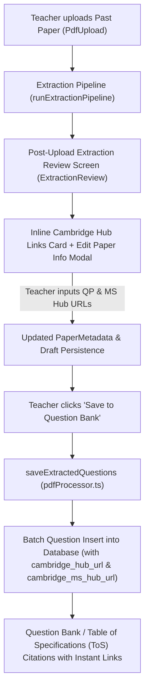

# Plan: Cambridge Support Hub Link Insertion on Post-Upload Review Page

## 1. Problem Statement
When teachers upload past papers, Cambridge School Support Hub links (for Question Paper and Mark Scheme) currently have to be added after the fact via the Past Paper PDF Manager modal or individual question editors. Teachers requested the ability to insert these Cambridge links directly on the post-upload extraction review page (`ExtractionReview.tsx`), ensuring that all newly extracted questions are immediately linked with their official Cambridge Support Hub QP and Mark Scheme URLs upon saving to the Question Bank.

---

## 2. Architecture & Data Flow



---

## 3. Implementation Steps

### Phase 1: Data Model & Pipeline Enhancements
1. **`src/types/database.ts`**:
   - Extend `PaperMetadata` to include:
     ```ts
     cambridge_hub_url?: string | null;
     cambridge_ms_hub_url?: string | null;
     ```
2. **`src/lib/pdfProcessor.ts` (`saveExtractedQuestions`)**:
   - Ensure `effectiveHubUrl` resolves from `q.cambridge_hub_url || paper_metadata.cambridge_hub_url || ...`.
   - Ensure `effectiveMsHubUrl` resolves from `q.cambridge_ms_hub_url || paper_metadata.cambridge_ms_hub_url || ...`.
   - Stamp both fields on native columns and `mark_scheme._cambridge_hub_url` / `_cambridge_ms_hub_url` for every saved question.

### Phase 2: Post-Upload Review Page UI (`ExtractionReview.tsx`)
1. **Interactive Inline Links Panel**:
   - Add a clean, responsive banner card between `review-meta-grid` and `review-selection-bar`:
     - 🔗 **Cambridge School Support Hub Links (for ToS Citations)**
     - Field 1: **Question Paper (QP) Link** (`https://schoolsupporthub.cambridge.org/item/...`)
     - Field 2: **Mark Scheme (MS) Link** (`https://schoolsupporthub.cambridge.org/item/...`)
   - Include real-time validation via `validateCambridgeHubUrl`:
     - ✓ Green check badge for official Cambridge Hub URLs.
     - ℹ️ Amber info badge for generic HTTPS links.
     - ⚠️ Red error badge for invalid URLs.
2. **Edit Paper Details Modal (`isEditingMetadata`)**:
   - Add matching QP Hub URL and MS Hub URL inputs in the metadata modal grid with clear helper guidance.
3. **Auto-Save Draft Integration**:
   - When URLs are updated, synchronize them with `paperMetadata` and auto-save the draft to IndexedDB (`saveUploadDraft`), ensuring work is never lost on refresh.

### Phase 3: Optional Staging Support (`PdfUpload.tsx`)
1. Add optional Cambridge Hub link fields in the right-column upload settings so teachers can paste them upfront if they already have them copied.
2. Pass them into `runExtractionPipeline` options so `ExtractionReview` opens with them pre-filled.

### Phase 4: CSS & Design System Polish
1. In `src/components/ExtractionReview.css` and `src/components/PdfUpload.css`:
   - Style the links card with accessible focus rings, status indicators, and clean typography matching ICM testmaker standards.

### Phase 5: Verification & Testing
1. Create dedicated verification test script: `scripts/test-post-upload-cambridge-links.mjs`.
2. Run full test suite:
   - `npm run test:tos-citations`
   - `npm run test:emergency; npm run test:emergency:sim; npm run test:sorting; npm run test:blooms`
   - `npm run build`
   - `npm run lint`

---

## 4. Verification Checklist
- [ ] Post-upload review screen displays Cambridge QP and MS Hub input fields.
- [ ] Input fields validate URLs and show instant feedback.
- [ ] Editing in "Edit Paper Details" modal stays in sync with inline card.
- [ ] Saving questions applies both URLs to all questions in Supabase (`questions` table & `mark_scheme` JSONB).
- [ ] Auto-save draft in IndexedDB preserves links across reloads.
- [ ] All test suites, build, and linter pass with 0 errors.

