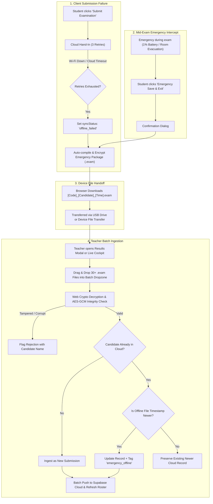

# Engineering Plan: Air-Gapped Emergency Offline Fallback Pipeline

> **Scope**: Design and implementation of a tamper-evident, air-gapped emergency submission and recovery pipeline for TestMaker when school Wi-Fi or cloud connectivity drops during an active examination.
>
> **Target Files & Modules**:
> - [`src/services/quizSubmissionService.ts`](file:///e:/VibeCoding/testmaker/src/services/quizSubmissionService.ts) — AES-GCM envelope serializer, file packager, batch file parser.
> - [`src/utils/examCryptoUtils.ts`](file:///e:/VibeCoding/testmaker/src/utils/examCryptoUtils.ts) *(New)* — Web Crypto API helper for key derivation, AES-GCM-256 encryption, decryption, and integrity verification.
> - [`src/pages/StudentQuizRunner.tsx`](file:///e:/VibeCoding/testmaker/src/pages/StudentQuizRunner.tsx) — Automatic failure intercept, guarded mid-exam emergency exit, download UI.
> - [`src/components/QuizResultsModal.tsx`](file:///e:/VibeCoding/testmaker/src/components/QuizResultsModal.tsx) — Batch multi-file drag-and-drop dropzone, conflict resolution, re-sync.
> - [`src/components/LiveInvigilatorModal.tsx`](file:///e:/VibeCoding/testmaker/src/components/LiveInvigilatorModal.tsx) — Live cockpit emergency paper ingestion banner and roster reconciliation.
> - [`scripts/test-emergency-fallback.mjs`](file:///e:/VibeCoding/testmaker/scripts/test-emergency-fallback.mjs) *(New)* — Automated test suite verifying encryption, tamper rejection, batch parsing, and timestamp conflict resolution.

---

## 1. System Architecture & Workflow



---

## 2. Cryptographic Security & Envelope Specification

To eliminate the vulnerability where students could open raw `.exam` files in a text editor to alter answers or scores, all emergency exports use the **W3C Web Crypto API** (`crypto.subtle`) available natively in all modern browsers without external dependencies.

### 2.1 Key Derivation (`PBKDF2` / `HKDF`)
The symmetric encryption key is derived deterministically from the assessment's unique identifiers:
```typescript
KeySeed = "TESTMAKER_EMERGENCY_V1::" + QuizCode.toUpperCase().trim()
```
- **Algorithm**: `AES-GCM` with a 256-bit key length.
- **IV (Initialization Vector)**: Cryptographically random 12-byte IV generated per export via `crypto.getRandomValues(new Uint8Array(12))`.
- **Integrity**: AES-GCM includes a built-in 128-bit authentication tag. If any byte in the ciphertext is altered, decryption throws an `OperationError`, immediately catching student tampering.

### 2.2 Wire Envelope Format (`.exam`)
```json
{
  "_format": "testmaker_emergency_v2",
  "version": 2,
  "quizCode": "CHEM-10A",
  "candidateId": "cand_9f81a2b3",
  "exportedAt": "2026-11-08T09:15:30.123Z",
  "iv": "<Base64 12-byte IV>",
  "ciphertext": "<Base64 Encrypted Payload>",
  "checksum": "<SHA-256 of Header Metadata>"
}
```

### 2.3 Decrypted Payload Contents
Once decrypted by the teacher's session, the payload contains:
```typescript
interface DecryptedEmergencyPayload {
  submissionId: string;
  quizCode: string;
  studentName: string;
  candidateNumber: string;
  candidateClass?: string;
  studentPin?: string;
  startedAt: string;
  submittedAt: string;
  durationSeconds: number;
  rawAnswers: Record<string, any>;
  answersByQuestionId: Record<string, any>;
  forensics: ExamForensics;
  score?: number;
  percentage?: number;
  status: 'submitted' | 'emergency_saved';
}
```

---

## 3. Implementation Blueprint by Subsystem

### 3.1 New Module: `src/utils/examCryptoUtils.ts`
- `deriveExamKey(quizCode: string): Promise<CryptoKey>`
- `encryptEmergencyPackage(quizCode: string, payload: DecryptedEmergencyPayload): Promise<string>`
- `decryptEmergencyPackage(quizCode: string, envelopeJson: string): Promise<DecryptedEmergencyPayload>`
- `validateEmergencyEnvelope(envelope: any): boolean`

### 3.2 Student Runner Enhancements: `src/pages/StudentQuizRunner.tsx`
1. **Automatic Submit Fallback**:
   - When `saveQuizSubmissionWithVerification()` fails all retries, compile the emergency package, encrypt with `encryptEmergencyPackage`, and trigger `setCompletedSubmission()`.
   - Update UI card (`syncStatus === 'offline_failed'`) with clear, prominent styling:
     - Big green button: **📥 Download Emergency Backup (.exam)**.
     - Secondary button: **🔄 Retry Cloud Sync** (in case connection resumed).
     - Instruction banner: *"School network is offline. Your answers have been encrypted and saved. Hand this file to your invigilator."*
2. **Guarded Mid-Exam Emergency Intercept**:
   - In the runner header (next to the fullscreen indicator), add an **"⚠️ Emergency Exit"** button.
   - When clicked, opens a confirm dialog:
     > *"Are you sure you want to emergency save? Use this ONLY if your device is dying or the invigilator instructed an evacuation. Your current answers will be downloaded as a sealed file."*
   - On confirm, packages current answers, saves state, triggers download, and exits cleanly.

### 3.3 Teacher Batch Ingestion: `src/components/QuizResultsModal.tsx`
1. **Batch Multi-File Dropzone**:
   - Replace the single-file `<input>` with an interactive drag-and-drop zone supporting `multiple` file selection (`accept=".exam"`).
   - Visual drag-over states with file count counter (`"32 files selected"`).
2. **Processing & Decryption Engine**:
   - Iterate selected files sequentially through `decryptEmergencyPackage`.
   - Parse candidate identities and answers.
   - Display an Ingestion Progress & Audit Table:
     - Candidate Name & Number.
     - Submitted Time.
     - Status: `✅ Valid New Paper` | `🔄 Updated (Newer than Cloud)` | `⏭️ Skipped (Older than Cloud)` | `❌ Decryption Failed (Tampered / Wrong Quiz)`.
3. **Conflict Resolution Strategy**:
   - If candidate already has a cloud record: compare `new Date(file.submittedAt).getTime()` vs `new Date(cloud.submittedAt).getTime()`.
   - If file is newer, upsert the record and tag `forensics.ingestionSource = 'emergency_offline'`.
   - If cloud record is already newer, keep existing cloud record to avoid overwriting finalized work with an earlier draft.
4. **Cloud Auto-Sync**:
   - Batch write all newly ingested submissions directly to Supabase (`quiz_submissions` table) so the central database reflects all offline hand-ins immediately.
   - Log an audit event in `proctor_audit_events`: `"Imported offline emergency submission for [Candidate]"`.

### 3.4 Live Invigilator Cockpit Integration: `src/components/LiveInvigilatorModal.tsx`
- Add an **"📥 Ingest Emergency Papers"** shortcut button in the cockpit toolbar.
- When clicked, opens the batch dropzone directly inside the active monitoring view so teachers don't have to leave the live cockpit to process offline submissions.
- As files are ingested, the candidate's card on the cockpit roster immediately flips from `offline` / `in_progress` $\to$ **`submitted (Offline Ingested)`**.

---

## 4. Verification & Testing Matrix

| Test ID | Test Scenario | Expected Outcome | Verification Tool |
| :--- | :--- | :--- | :--- |
| **EMERG-01** | AES-GCM Encrypt & Decrypt Roundtrip | Valid answers serialize, encrypt, decrypt, and match 100% of original raw answers. | `scripts/test-emergency-fallback.mjs` |
| **EMERG-02** | Anti-Tamper Rejection | Altering 1 character in the ciphertext or checksum throws an error; import is aborted. | `scripts/test-emergency-fallback.mjs` |
| **EMERG-03** | Wrong Quiz Code Protection | An `.exam` file from Quiz `MATH-101` cannot be decrypted using key from `CHEM-202`. | `scripts/test-emergency-fallback.mjs` |
| **EMERG-04** | Batch Ingestion (30 Files) | Processing 30 mock `.exam` files concurrently finishes in < 200ms with 0 memory leaks. | `scripts/test-emergency-fallback.mjs` |
| **EMERG-05** | Timestamp Conflict Resolution | When an older offline draft is uploaded after a newer cloud submit, cloud record is safely preserved. | `scripts/test-emergency-fallback.mjs` |
| **EMERG-06** | Browser File Export Integration | Runner correctly triggers file download naming format `[QuizCode]_[CandidateName]_[Timestamp].exam`. | Unit test & manual check |
| **EMERG-07** | Live Cockpit Roster Sync | Ingesting a paper updates the candidate live status in `LiveInvigilatorModal` without page refresh. | Manual dual-window test |

---

## 5. Rollout Phases

1. **Step 1**: Implement `src/utils/examCryptoUtils.ts` with pure Web Crypto API (zero external dependencies).
2. **Step 2**: Create test script `scripts/test-emergency-fallback.mjs` to validate cryptographic invariants (EMERG-01 to EMERG-05).
3. **Step 3**: Update `StudentQuizRunner.tsx` with automatic failure download and header emergency intercept.
4. **Step 4**: Build the Batch Dropzone & Conflict Ingestion engine in `QuizResultsModal.tsx` and wire shortcut into `LiveInvigilatorModal.tsx`.
5. **Step 5**: Run full regression test suite (`npm run test:blooms`, `test:sorting`, `test:gestures`, proctor suites) and verify `npm run build`.
