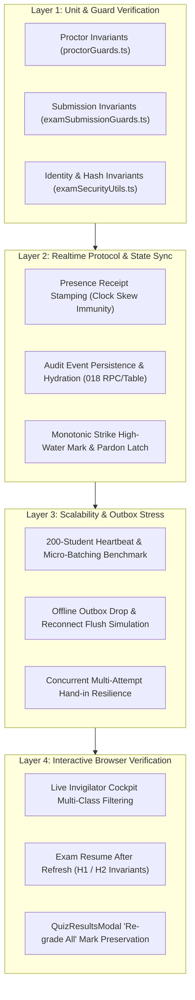

# Testing Plan: Proctoring, Cockpit Scalability, and Exam Mode Submission Pipeline

> **Scope**: Validation and quality assurance for:
> 1. **Live Proctor / Invigilator Hardening** (P1, P2, P3 reliability & security fixes)
> 2. **Multi-Class Cockpit Scalability** (200+ concurrent students, jitter, micro-batching, roster reconciliation)
> 3. **Exam Mode Submission & Grading Pipeline** (Attempt resume, re-grading mark preservation, timer anchoring, outbox resilience, trust boundaries)
>
> **Target Files & Subsystems**:
> - [`src/lib/proctorGuards.ts`](file:///e:/VibeCoding/testmaker/src/lib/proctorGuards.ts) & [`src/services/examProctorRealtimeService.ts`](file:///e:/VibeCoding/testmaker/src/services/examProctorRealtimeService.ts)
> - [`src/components/LiveInvigilatorModal.tsx`](file:///e:/VibeCoding/testmaker/src/components/LiveInvigilatorModal.tsx)
> - [`src/lib/examSubmissionGuards.ts`](file:///e:/VibeCoding/testmaker/src/lib/examSubmissionGuards.ts) & [`src/services/quizSubmissionService.ts`](file:///e:/VibeCoding/testmaker/src/services/quizSubmissionService.ts)
> - [`src/pages/StudentQuizRunner.tsx`](file:///e:/VibeCoding/testmaker/src/pages/StudentQuizRunner.tsx) & [`src/services/examDraftService.ts`](file:///e:/VibeCoding/testmaker/src/services/examDraftService.ts)
> - [`src/components/QuizResultsModal.tsx`](file:///e:/VibeCoding/testmaker/src/components/QuizResultsModal.tsx) & [`src/services/proctorAuditLogService.ts`](file:///e:/VibeCoding/testmaker/src/services/proctorAuditLogService.ts)

---

## 1. Test Architecture & Coverage Matrix

Testing is organized into four complementary layers:
- **Layer 1: Deterministic Unit & Guard Tests** (Offline, pure logic, zero-network).
- **Layer 2: Transport, Queue & Protocol Invariants** (WebSocket channel simulation, command latches, message queues).
- **Layer 3: Concurrency & Stress Simulation** (50 to 200 synthetic candidates, network jitter, outbox drops, concurrent hand-ins).
- **Layer 4: Real Browser & Interactive E2E Scenarios** (Invigilator cockpit live testing, student dual-browser sitting).



---

## 2. Test Verification Matrix

### Part 1: Live Proctor & Invigilator Hardening

| Test ID | Objective | Input / Condition | Expected Behavior | Verification Mode |
| :--- | :--- | :--- | :--- | :--- |
| **PROCT-01** | Clock Skew Immunity (`P1-A`) | Student laptop clock set 5 min behind and 1 hour ahead of teacher. | `stampHeartbeatReceipt` records arrival via teacher clock; candidate is marked active, NOT offline. | Automated (`test-proctor-p1-p2-p3.mjs`) |
| **PROCT-02** | Stale Heartbeat Sweep | Student closes tab; no heartbeat for >45 seconds. | Invigilator cockpit transitions status from `in_progress` to `offline` after 45s of genuine silence. | Layer 2 Script |
| **PROCT-03** | Single Row Identity (`P1-B`) | Candidate reloads browser 3 times with same name and candidate number. | Cockpit preserves exactly 1 candidate row; old session hashes resolve to canonical ID (`cand_...`). | Layer 2 Script & Manual |
| **PROCT-04** | Audit Log Persistence (`P1-C`) | Teacher executes `add_time`, `pardon`, and `unlock`; teacher reloads dashboard. | All interventions rehydrate from `proctor_audit_events` (or local fallback); zero state loss. | Automated & Manual |
| **PROCT-05** | Monotonic Strikes (`P2-B`) | Manipulated client sends lower strike count (e.g. 1 instead of 3). | Cockpit high-water mark rejects strike regression; only explicit `pardon` command lowers strikes. | Automated (`proctorGuards.ts`) |
| **PROCT-06** | Telemetry Clamping (`P2-B`) | Client telemetry sends `answeredCount: 999/20`, `timeLeft: -500`, or `add_time: -30`. | Clamped to valid ranges (`answeredCount <= total`, `timeLeft >= 0`, `add_time >= 1 min`). | Automated (`clampTelemetry`) |
| **PROCT-07** | Rate Limiting (`P2-C`) | Malicious/buggy client fires 20 log events in 2 seconds. | Rate limiter accepts first 5 events per 10s, drops the rest, and emits exactly 1 `rate_limit` notice. | Automated (`checkRateLimit`) |
| **PROCT-08** | Command Deduplication (`P3-1`) | Teacher clicks `+5 min` twice or network retries identical `cmd.id`. | Student runner applies command exactly once; second execution is safely dropped. | Automated (`claimCommandId`) |
| **PROCT-09** | Delta Violations (`P3-2`) | Student accumulates 25 violations over 1 hour. | Routine heartbeats carry only newest 5 violations; full history is sent only on explicit sync/submit. | Automated (`recentViolationsSlice`) |

---

### Part 2: Multi-Class Cockpit Scalability

| Test ID | Objective | Input / Condition | Expected Behavior | Verification Mode |
| :--- | :--- | :--- | :--- | :--- |
| **SCALE-01** | 200+ Student Heartbeat Burst | 200 concurrent student runners connected to same quiz code. | Jitter (12–18s with ±2.4s random spread) prevents network thundering herd; Supabase free tier limits unbreached. | Concurrency Simulation |
| **SCALE-02** | Micro-Batching (300ms) | 50 heartbeats arrive within 100ms. | Cockpit state updates batch into 300ms intervals instead of triggering 50 individual React re-renders. | Component Performance Benchmark |
| **SCALE-03** | Offscreen DOM Containment | Roster table with 200 student cards rendered in modal. | Cards below the fold utilize CSS `content-visibility: auto`, maintaining 60fps scrolling without DOM lag. | Chrome DevTools Performance Profiler |
| **SCALE-04** | Class-Targeted Routing | Teacher selects "Class 10-A" and issues `add_time`. | Command specifies `targetClass: '10-A'`; only students in 10-A receive extra time; 10-B is untouched. | Layer 2 Simulation |
| **SCALE-05** | Missing Roster Reconciliation | Official roster has 25 students; only 22 joined. | Cockpit shows 3 students in "Unregistered / Absent" list with instant status indicators. | Automated & UI Test |

---

### Part 3: Exam Mode Submission & Grading Pipeline

| Test ID | Objective | Input / Condition | Expected Behavior | Verification Mode |
| :--- | :--- | :--- | :--- | :--- |
| **SUBM-01** | Crash & Reload Resume (`H1`) | Student sitting in progress refreshes browser or experiences crash. | `didSubmitAttempt` returns `{ submitted: false }`; runner resumes draft with zero "Already submitted" lockout. | Automated (`test-exam-submission-fixes.mjs`) |
| **SUBM-02** | Submitted Attempt Lockout | Candidate who already clicked "Submit Examination" tries to access exam URL again. | `checkStudentAttemptSubmitted` detects true submission; runner presents locked "Already Submitted" screen. | Automated & Manual |
| **SUBM-03** | Wall-Clock Timer Anchor (`H2`) | Candidate starts 60-min exam at 10:00, closes tab for 10 min, reopens at 10:10. | `resolveResumeClock` anchors to `targetEndTime` (11:00); remaining time is 50 min, NOT 60 min. | Automated (`resolveResumeClock`) |
| **SUBM-04** | "Re-grade All" Data Protection (`C5`) | Teacher grades essay questions with AI/manual marks, then clicks "Re-grade All" (deterministic). | Deterministic grading updates MCQs; all essay scores and custom feedback remain 100% intact. | Automated & Manual |
| **SUBM-05** | Offline Outbox Recovery (`H4`) | Candidate submits exam with Wi-Fi disconnected; reconnects 2 minutes later. | Outbox stores attempt in `localStorage`, keeps status retryable, and auto-flushes on reconnect. | Automated & Network Throttling |
| **SUBM-06** | No Concurrent Overwrites (`H5`) | 50 students submit simultaneously at the end of the exam. | Submissions write directly to `quiz_submissions` table; fallback `app_config` array write avoids race corruption. | Concurrent Hand-in Test |
| **SUBM-07** | Mark Scheme Sanitization (`C2`) | Inspect student browser memory / DevTools network payload for active exam. | `mark_scheme`, `guidance`, and `teacherPin` are completely stripped from question payloads. | Automated (`sanitizeQuestionsForStudent`) |
| **SUBM-08** | Result Privacy Boundaries (`C3`) | Candidate inputs quiz code and name in student result viewer. | Server RPC returns only that candidate's record; school-wide submissions are never downloaded. | Automated & RPC Audit |
| **SUBM-09** | Shared Laptop Isolation (`H8`) | Candidate A finishes on lab laptop; Candidate B opens exam on same laptop. | Session key mismatch triggers foreign session reset; Candidate B never sees Candidate A's answers or strikes. | Automated (`shouldResetSessionForCandidate`) |
| **SUBM-10** | Keystroke Lag Elimination (`M4`) | Candidate types 1,000-word essay continuously in response area. | Autosave is debounced to 1,500ms quiet periods; zero main-thread input lag on low-end hardware. | Performance Trace |

---

## 3. Step-by-Step Test Execution Plan

### Step 1: Automated Invariant & Guard Suite Run
Run the deterministic unit test suites to verify that all mathematical, logical, and sanitization invariants hold true:
```bash
# 1. Run Proctor Guard Tests
node --import ./scripts/register-ts.mjs scripts/test-proctor-p1-p2-p3.mjs

# 2. Run Submission & Grading Guard Tests
node --import ./scripts/register-ts.mjs scripts/test-exam-submission-fixes.mjs

# 3. Run Gesture & Bezel Security Tests
npm run test:gestures
```

### Step 2: High-Concurrency Virtual Cohort Simulation
Execute the 200-student simulation script to benchmark concurrency, telemetry volume, and submission resilience:
```bash
node scripts/simulate_exam_security_200.mjs
```
*Verify*:
1. 200 candidates generate heartbeats across 20 questions without HTTP 429 rate limit errors.
2. Psychometric collision matrix handles 19,900 pairs in under 1 second.
3. Dual-tier persistence correctly structures student telemetry and answer revisions.

### Step 3: Outbox & Network Resilience Simulation
Create a simulation script (`scripts/test-outbox-resilience.mjs`) to test offline network drops:
1. Seed outbox with 5 student submissions.
2. Simulate failure on initial POST (simulated Wi-Fi dropout).
3. Validate that outbox marks items with exponential backoff (`isOutboxRetryable`).
4. Advance mock clock and trigger online event; verify all 5 submissions flush cleanly.

### Step 4: Interactive Browser Testing Checklist
Perform a dual-window test (Invigilator in Window 1, Student in Incognito Window 2):
1. **Clock Discrepancy**: Change Windows client system time back by 10 minutes; verify student remains green (`in_progress`) in invigilator modal.
2. **Teacher Interventions**: Click `+5 min` and `Unlock` from invigilator; verify student receives visual alert and timer updates immediately.
3. **Cockpit Reload**: Refresh the invigilator page; verify candidate cards, strike counts, and audit event history reload completely.
4. **Student Crash & Resume**: During the exam, close the student tab; reopen the exam URL, enter the same candidate details; verify draft answers and remaining time resume seamlessly.
5. **Re-grade Safety**: In Teacher Results modal with graded essay questions, click "Re-grade All"; verify total marks for essay items do not drop to zero.

---

## 4. Acceptance Gates

Before signing off, all of the following criteria must be satisfied:
* [ ] **0 Failures** in `test-proctor-p1-p2-p3.mjs` and `test-exam-submission-fixes.mjs`.
* [ ] **0 Data Loss** during "Re-grade All" in `QuizResultsModal` across mixed MCQ + Structured papers.
* [ ] **0 Duplicate Rows** in `LiveInvigilatorModal` when candidates refresh or toggle fullscreen.
* [ ] **0 Clock-Skew False Positives**: Candidates with out-of-sync local clocks remain active.
* [ ] **0 Leaked Secrets**: Network inspector confirms `mark_scheme`, `guidance`, and `teacherPin` never appear in student exam payload.
* [ ] **Clean Production Build**: `npm run build` completes with exit code 0.

