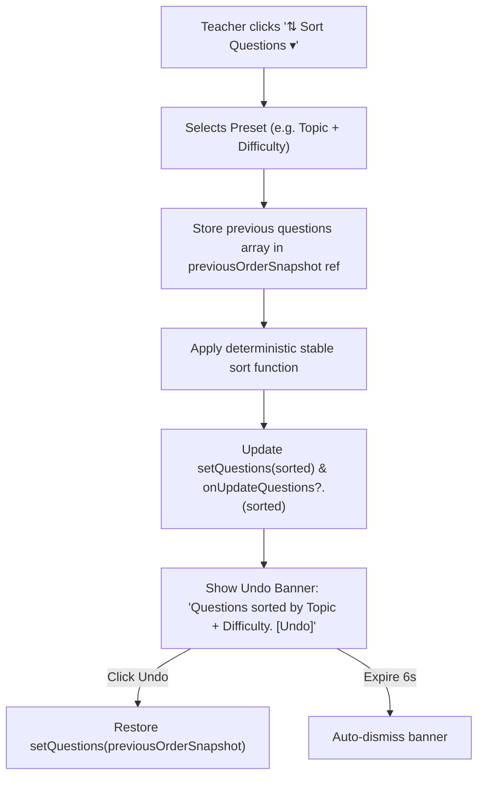

# Test Builder Question Sorting Feature Implementation Plan

## 1. Overview & Objectives

In the **Test Builder Workspace** ([`TestBuilderPage.tsx`](file:///e:/VibeCoding/testmaker/src/pages/TestBuilderPage.tsx)), teachers assemble and sequence questions for custom tests and exam papers. Currently, questions must be arranged purely through manual `▲` and `▼` step buttons. 

This feature adds a sorting system that allows teachers to reorder all questions in the test with a single click based on:
1. **Topic (A → Z)**
2. **Difficulty (Easy → Hard)**
3. **Difficulty (Hard → Easy)**
4. **Topic + Difficulty (Grouped by Topic, then Easy → Hard)**
5. **Shuffle / Randomize**

It includes an instant **Undo** capability so teachers can experiment freely with different orderings without fear of losing their customized sequence.

---

## 2. Aligned Design Specifications (Grill-Me Alignment)

| Aspect | Aligned Specification |
| :--- | :--- |
| **Section & Format Integrity** | **MCQ First, Essays/Structured Second (Section Parity)**: In assessments containing both Multiple Choice and Essay/Structured/Theory questions, questions are strictly partitioned into standard exam sections:<br/>• **Section A (MCQs)**: Sorted internally according to the chosen preset.<br/>• **Section B (Theory / Essays)**: Sorted internally according to the chosen preset.<br/>MCQ questions **never** scatter into the essay section, and essay questions **never** jump in front of MCQs. |
| **Execution Model** | **One-Click Reorder with Undo**: Mutates the actual test questions array so `Question 1, 2, 3...`, PDF/Word exports, and Student Quiz runners immediately adopt the new sequence. |
| **Undo Toast** | Displays a transient notification: `"✓ Questions sorted by [Preset Name]."` with an active `"Undo"` action button that restores the exact previous order (auto-dismisses after 6s). |
| **Presets Available** | 1. 📚 **Topic (A → Z)**<br/>2. ⚡ **Difficulty (Easy → Hard)**<br/>3. 🔥 **Difficulty (Hard → Easy)**<br/>4. 🎯 **Topic + Difficulty (Topic A → Z, then Easy → Hard)**<br/>5. 🎲 **Shuffle / Randomize (Shuffles within sections)** |
| **UI Placement** | **Question Section Header**: Positioned on the right side of `builder-section-header` in [`TestBuilderPage.tsx`](file:///e:/VibeCoding/testmaker/src/pages/TestBuilderPage.tsx) as a compact `⇅ Sort Questions ▾` dropdown button next to the question count and the `Use ▲ ▼ to reorder questions` hint. |
| **Tie-Breaking Rules** | **Format Section First → Natural Progression**:<br/>• Primary = Format Section (MCQ = 0, Essay/Structured = 1)<br/>• Secondary = Topic / Difficulty / Sub-Topic according to selected preset<br/>• Fallback = Original relative order |

---

## 3. Sorting Algorithms & Weighting

```ts
const isMcq = (q: Question) =>
  q.question_style === 'Multiple Choice' ||
  q.question_style === 'Multiple Select' ||
  (Array.isArray(q.options) && q.options.length >= 2);

const getSectionRank = (q: Question) => (isMcq(q) ? 0 : 1);

const DIFFICULTY_WEIGHT: Record<string, number> = {
  Easy: 1,
  Medium: 2,
  Hard: 3,
};
// Unassigned difficulties fall back to 4 (placed at the end)
```

### Natural Sort Key Comparison:
1. **Topic (A → Z)**:
   ```ts
   getSectionRank(a) - getSectionRank(b)
     || compare(a.topic || 'General', b.topic || 'General')
     || compare(a.sub_topic || '', b.sub_topic || '')
     || (DIFFICULTY_WEIGHT[a.difficulty || ''] || 4) - (DIFFICULTY_WEIGHT[b.difficulty || ''] || 4)
   ```
2. **Difficulty (Easy → Hard)**:
   ```ts
   getSectionRank(a) - getSectionRank(b)
     || (DIFFICULTY_WEIGHT[a.difficulty || ''] || 4) - (DIFFICULTY_WEIGHT[b.difficulty || ''] || 4)
   ```
3. **Difficulty (Hard → Easy)**:
   ```ts
   getSectionRank(a) - getSectionRank(b)
     || (DIFFICULTY_WEIGHT[b.difficulty || ''] || 0) - (DIFFICULTY_WEIGHT[a.difficulty || ''] || 0)
   ```
4. **Topic + Difficulty**:
   ```ts
   getSectionRank(a) - getSectionRank(b)
     || compare(a.topic || 'General', b.topic || 'General')
     || compare(a.sub_topic || '', b.sub_topic || '')
     || (DIFFICULTY_WEIGHT[a.difficulty || ''] || 4) - (DIFFICULTY_WEIGHT[b.difficulty || ''] || 4)
   ```
5. **Shuffle**:
   Shuffles within the MCQ section and within the Theory/Essay section independently, ensuring MCQs stay in Section A and Essays stay in Section B without intermingling.

---

## 4. Architecture & Implementation Steps



### Step 1: Utility Sorter Function Module
- **File**: `src/utils/testSortingUtils.ts` (or inside `src/services/testBuilderService.ts`)
- Implement:
  - `sortQuestionsByTopic(questions: Question[]): Question[]`
  - `sortQuestionsByDifficulty(questions: Question[], direction: 'asc' | 'desc'): Question[]`
  - `sortQuestionsByTopicAndDifficulty(questions: Question[]): Question[]`
  - `shuffleQuestions(questions: Question[]): Question[]`
  - Helper to format the preset label for toast alerts.

### Step 2: UI Dropdown Component
- **File**: `src/pages/TestBuilderPage.tsx`
- Add state:
  - `isSortDropdownOpen: boolean`
  - `undoSortSnapshot: Question[] | null`
  - `undoSortLabel: string | null`
- Render the dropdown menu in `builder-section-header`:
  - Backdrop click-outside listener to close menu.
  - Keyboard accessible (`Escape` to close).
  - Modern styling matching the TestMaker design system (subtle borders, hover transitions, icons).

### Step 3: Undo Banner & Toast
- If `undoSortSnapshot` is present:
  - Render an alert banner above the questions list with:
    - Label: `✓ Questions sorted by [Preset Name]`
    - Action button: `↩ Undo` (restores original order)
    - Dismiss button: `✕`

### Step 4: CSS & Responsive Layout
- Ensure the dropdown menu and undo banner respond smoothly to mobile, tablet, and desktop viewports without overflowing.

---

## 5. Verification & Testing

1. **Automated Unit Tests**:
   - Create `scripts/test-builder-sorting.mjs` verifying:
     - All 5 sort presets produce the exact expected order.
     - Sub-topics and difficulty tie-breaks work as expected.
     - Unassigned topics/difficulties do not crash and sort predictably to the end.
     - Undo restores the exact byte-for-byte original array.
2. **Integration Verification**:
   - Run `npm run test:blooms`, `npm run test:gestures`, `npm run test:gforms`.
   - Run `npm run build` to verify TypeScript types and production compilation.

