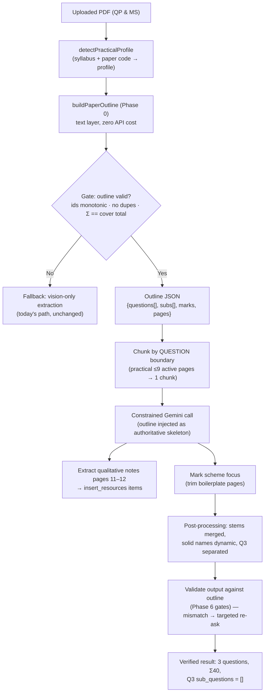

# Implementation Plan: IGCSE Chemistry Practical Paper (Paper 5 / 6) Extraction Optimization

## 1. Executive Summary & Objective

Empirical analysis of the 24 question papers in `H:\My Drive\References\PAST PAPER (2023 -2025)\Practical Paper Deepseek` (0620/51, /52, /53 — Nov 2021 → Jun 2026) establishes what is actually invariant, and what is not. Numbers below are measured, not assumed.

### 1.1 Verified invariants (24/24 papers, 0620/5x)

- **Total Marks**: exactly **40** in 24/24 papers.
- **Three questions** in 24/24 papers.
  - **Question 1 (16–20 marks)**: quantitative/experimental investigation (titration, rates, thermochemistry, gas collection). Multi-step procedure (`Experiment 1`–`5`), data table (`Table 1.1`), and evaluative parts.
  - **Question 2 (14–18 marks)**: qualitative analysis (cations, anions, gases), with dual observation cues (`dropwise: …`, `in excess: …`) where ammonia is used.
  - **Question 3 (exactly 6 marks)**: standalone extended-response investigation. **Zero sub-parts in 24/24.**
- **Page structure**: 12 pages; active question pages **3–9**; page 10 blank; **pages 11–12** are *"Notes for use in qualitative analysis"*.
- **Sub-question topology**: 467 leaves across 24 papers; part letters run `(a)`…`(k)`, romans `(i)`…`(iv)`.

### 1.2 Not invariant — do not encode as rules

| Assumption | Measured reality |
|---|---|
| Q1 always contains `Fig. 1.1` | `Fig. 1.x` present in **11/24**; a plot is requested in **19/24**; **5 papers have no graph** |
| Q3 always says "Plan an investigation" | **16/24** by phrasing; real wordings include "Plan an experiment…", "Describe how you could obtain a sample of bismuth…" |
| Notes phrases appear only on pages 11–12 | The **cover page** of every paper says "Notes for use in qualitative analysis are provided in the question paper" |
| Pattern holds for Paper 6 (0620/6x) | **Zero 6x samples** in the corpus — unverified |
| Pattern holds for 9701 | 9701/5x is **30 marks, 2 questions** (measured on 5 papers), not 40/3 |

### 1.3 Objective

100% **structural** fidelity (questions, sub-question ids, marks) guaranteed by a deterministic parser, with content best-effort by the LLM, and a hard gate that falls back to today's vision path when structure cannot be proven. "100% content fidelity" is explicitly **not** a target — it is unmeasurable and it is what the current prompt-only approach pretends to achieve.

---

## 2. End-to-End Extraction Pipeline Architecture



---

## 3. Detailed Work Breakdown

### Phase 0: Deterministic Paper Outline (new — the load-bearing phase)
**Target Files**: new [paperOutline.ts](file:///e:/VibeCoding/testmaker/src/lib/paperOutline.ts), [pdfChunker.ts](file:///e:/VibeCoding/testmaker/src/lib/pdfChunker.ts) (reuse the existing `pdfjs-dist` worker setup)

- [ ] **`buildPaperOutline(bytes: Uint8Array): PaperOutline`** — reads the PDF **text layer** via `page.getTextContent()`; no API calls, ~100–300 ms for 12 pages.
  - [ ] Noise filter: `DO NOT WRITE IN THIS MARGIN`, `* 0000… *`, `DFD`, UCLES footer, barcode glyph soup (non-Latin ratio > 35%), header/footer bands as **fractions of page height** (`<4.5%`, `>95.5%`), never absolute pixels.
  - [ ] Body font height = **modal glyph height** per page (11 here, 12 elsewhere) — not a constant.
  - [ ] Re-attach detached sub/superscripts (`cm` + `3` → `cm3`) by x-gap and y-offset against the nearest body token.
  - [ ] Line assembly by y-clustering, then infer **this paper's** columns by modal x: question column (~50), part column (~71–72), roman column (~89–96). No hardcoded x.
  - [ ] Anchors: `^\d{1,2}\s+[A-Z]` at the question column → question; `^(\([a-z]\))` at the part column → part; `^(\((i|ii|iii|iv|v|vi)\))` at the roman column → roman.
  - [ ] **`(i)` is ambiguous** (part letter in `(a)`…`(k)` papers, roman numeral in others) — resolve by **column**, never by regex. 10/24 papers use letters past `(h)`; getting this wrong silently mislabels them.
  - [ ] Marks: `[n]` whose line right-edge exceeds **86% of page width**; `[Total: X]` sets the question total; Q3 has no `[Total]` — its mark comes from the trailing `[6]`.
- [ ] **`PaperOutline` shape** (mirrors the existing types; no DB migration):
  ```ts
  { syllabus, paper, totalMarks, pages: {index, kind: 'cover'|'question'|'blank'|'notes'}[],
    questions: [{ number, page, declaredTotal,
                  subs: [{ id: '(f)(iii)', page, marks: number|null, isStem: boolean }] }] }
  ```
- [ ] **`isStem` detection**: a leaf whose marks are `null` and which is followed by children (`(c)` before `(c)(i)`) is a section stem, not a question. Its text merges into the first child.
- [ ] **Reference-page classification** by page index + heading-at-top-of-page; **never** by phrase presence (the cover mentions the notes).
- [ ] **Gate** (`outlineIsUsable`): ≥ 2 questions, ≥ 1 leaf per question, ids unique, sequence monotonic, no `*` artefacts, `Σ marks == cover total`. Failing papers fall through to the vision path — a bad outline must never reach the model.
- [ ] **Measured baseline to preserve as fixtures**: 24/24 papers, 467 leaves, 0 orphan marks, 0 duplicate ids, 0 non-monotonic sequences, Σ40 on every paper.

### Phase 1: Automatic Practical Detection & Single-Pass Chunking
**Target Files**: [pdfChunker.ts](file:///e:/VibeCoding/testmaker/src/lib/pdfChunker.ts), [pdfProcessor.ts](file:///e:/VibeCoding/testmaker/src/lib/pdfProcessor.ts), [PdfUpload.tsx](file:///e:/VibeCoding/testmaker/src/components/PdfUpload.tsx)

- [ ] **`detectPracticalProfile(bytes, fileName)`** → profile key, not a boolean:
  | Profile | Total | Questions | Q3 | Status |
  |---|---|---|---|---|
  | `0620/5x` | 40 | 3 | 6 marks, no subs | **verified, 24 papers** |
  | `9701/5x` | 30 | 2 | — | measured, 5 papers |
  | `0620/6x` | ? | ? | ? | **unknown — no samples** |
  | other (0625, 0610, 9701/3x) | — | — | — | out of scope until sampled |
  - Detection signals: filename/code (`0620/5\d`), cover text (`Paper 5 Practical Test`), body cues (`You are going to investigate`, `Tests on solid`).
  - **Do not** register patterns for syllabi that have not been measured — an unknown profile must degrade to the generic path, not to a wrong 40-mark prompt.
- [ ] **UI indicator** ([PdfUpload.tsx](file:///e:/VibeCoding/testmaker/src/components/PdfUpload.tsx)): badge `"Cambridge Practical 0620/5x • outline-verified • single pass"`, and a distinct warning badge when the outline gate fails.
- [ ] **Single-pass policy**: in `splitPdfForParallelExtraction`, if a verified practical outline exists and active pages ≤ 9, force `numChunks = 1` and disable overlap. *(Current code splits ≤12 pages into 2 chunks with 3-page overlap — `pdfChunker.ts:214+` — which is what severs Q2 across pages 6–8.)*
- [ ] **Chunk at question boundaries** when > 1 chunk is needed: the outline supplies `Q1 ⊂ {3,4,5}`, `Q2 ⊂ {6,7,8}`, so a chunk never starts mid-question.

### Phase 2: Qualitative Analysis Notes as Resource Booklet Assets
**Target Files**: [pdfProcessor.ts](file:///e:/VibeCoding/testmaker/src/lib/pdfProcessor.ts), [diagramCropper.ts](file:///e:/VibeCoding/testmaker/src/lib/diagramCropper.ts), [ResourceBookletDrawer.tsx](file:///e:/VibeCoding/testmaker/src/components/ResourceBookletDrawer.tsx)

- [ ] **Detect notes pages structurally**: the last 1–2 pages whose body text begins with `Tests for anions` / `Tests for aqueous cations` / `Tests for gases` / `Flame tests for metal ions`, matched **at the top of the page** and **excluding page 1** (every cover contains the phrase "Notes for use in qualitative analysis are provided…").
- [ ] Exclude those pages from the extraction prompt so the model cannot hallucinate questions from reference tables (also enforced by the outline gate).
- [ ] **Ingest as resources**: render pages 11–12 via [diagramCropper.ts](file:///e:/VibeCoding/testmaker/src/lib/diagramCropper.ts) and push into `ExtractionResult.insert_resources` (type already exists at [database.ts:356](file:///e:/VibeCoding/testmaker/src/types/database.ts:356)):
  - `{ id: "notes-qualitative-1", title: "Tests for anions and aqueous cations", target_questions: ["2"], page_number: 11 }`
  - `{ id: "notes-qualitative-2", title: "Tests for gases and flame tests", target_questions: ["2"], page_number: 12 }`
- [ ] **Exam runner**: Question 2 surfaces a shortcut into the Resource Booklet drawer.

### Phase 3: Dedicated Practical Prompt — now *constrained* by the outline
**Target File**: [gemini.ts](file:///e:/VibeCoding/testmaker/src/lib/gemini.ts)

- [ ] **`getCambridgePracticalExtractionPrompt(outline)`** — the outline goes in as fact; the prompt stops asking the model to discover structure:
  ```text
  AUTHORITATIVE STRUCTURE (extracted from the PDF text layer — do not add, drop, renumber or re-nest):
  Q1: (a)[5] (b)[4] (c)[2] (d)[3] (e)[1] (f)(i)[1] (f)(ii)[1] (g)[2]  total 19
  Q2: (a)[2] (b)(i)[2] (b)(ii)[1] …                                     total 15
  Q3: no sub-parts, total 6
  Return exactly these objects, in this order, with these ids and marks.
  ```
- [ ] **Q1**: transcribe all experiment instructions verbatim into `question_text`; emit `Table 1.1` twice (Markdown + `data_tables`).
- [ ] **Graph binding is conditional**: attach a `diagram_type: "graph"` figure to the plotting part **only if** the outline/questions ask to plot (19/24) — do **not** mandate `Fig. 1.1`, and do not trust the caption text when the grid is an embedded image (caption lives inside the raster).
- [ ] **Q2**: never merge into Q1; keep pre-treatment instructions in the stem; preserve `dropwise` / `in excess` cues where printed; capture the ion deduction.
- [ ] **Q3**: `sub_questions: []`, `total_marks: 6`, six marking points in `mark_scheme.marking_points`.
- [ ] **Output budget**: either raise `maxOutputTokens` ([gemini.ts:2528](file:///e:/VibeCoding/testmaker/src/lib/gemini.ts#L2528), currently 16384) or issue one call per question — the outline makes page ranges per question available, so this is cheap. A single 9-page call carrying Q1's full procedure + two tables + three mark schemes is a real truncation risk.
- [ ] **Routing**: `getExtractionPrompt` selects the practical prompt only when a profile + usable outline exist.

### Phase 4: Mark Scheme Handling
**Target Files**: [pdfProcessor.ts](file:///e:/VibeCoding/testmaker/src/lib/pdfProcessor.ts), [gemini.ts](file:///e:/VibeCoding/testmaker/src/lib/gemini.ts)

- [ ] **Do not text-match the MS tables.** Cambridge "published" mark schemes are landscape PDFs whose text layer extracts scrambled (`PUBLISHED /`, interleaved lines) — verified on the June 2023/51 MS. Page detection by `Question | Answer | Marks` is not reliable.
- [ ] Trim boilerplate by **structure instead**: skip leading pages until a page contains ≥ N rows with `^\d+\([a-z]\)` or a marks column pattern; if detection is ambiguous, pass the MS as images and let the model page through it (vision handles the landscape layout better than the text layer).
- [ ] Keep the MS aligned per question rather than per chunk, using the same outline boundaries.

### Phase 5: Post-Processing & Boundary Repair
**Target File**: [pdfProcessor.ts](file:///e:/VibeCoding/testmaker/src/lib/pdfProcessor.ts)

- [ ] **Fix in-place mutation in `separatePracticalQuestions`** ([pdfProcessor.ts:631](file:///e:/VibeCoding/testmaker/src/lib/pdfProcessor.ts#L631)): it assigns into the caller's `questions[...]` array while iterating it. Build an immutable result and return it; also guarantees no duplicate Q2 when Q2 precedes Q1 in the array.
- [ ] **Dynamic solid/solution naming**: replace the hardcoded stem at [pdfProcessor.ts:642](file:///e:/VibeCoding/testmaker/src/lib/pdfProcessor.ts#L642) with extraction from the paper (`solid A`, `solid E`, `solids F and G`, `solids M and N`, `substances H and I`, `solution F and solid G`). 24/24 papers differ here.
- [ ] **Q3 separation by structure, not phrasing**: last question + 6 marks + zero sub-labels + long dotted answer area. Keep a phrasing hint only as a tiebreaker (`Plan an (investigation|experiment)`, `Describe how`, `Suggest a method`, `Outline a procedure`, `Your plan (must|should) include`) — the current list alone matches only 16/24.
- [ ] **Stem merging**: `isStem` leaves fold into their first child so the DB never stores a sub-question with `marks: 0` and no answer space.
- [ ] Normalise `cm3` → `cm³`, `Fe` superscripts, and dotted answer runs → `____`.

### Phase 6: Verification — automated gates, not a checklist

- [ ] **Fixture suite**: the 24 QPs in `Practical Paper Deepseek` become `src/lib/__fixtures__/paper5/*.pdf` (or a JSON of expected outlines). Regression runs offline, no API key required.
- [ ] **Outline-level assertions** (per paper):
  - exactly 3 questions; Σ marks = 40
  - Q1 ∈ [16,20], Q2 ∈ [14,18], Q3 = 6 and `subs.length === 0`
  - no duplicate ids, monotonic sequence, no `*` artefacts
  - pages 11–12 classified `notes`, page 1 `cover`, page 10 `blank`
- [ ] **Extraction-level assertions** (LLM output vs outline):
  - returned ids === outline ids (set equality, order-insensitive)
  - Σ(leaf marks) === outline total per question
  - Q1 `question_text` contains every `Experiment n` block when the paper has one
  - zero occurrences of `Notes for use in qualitative analysis|BLANK PAGE|Tests for anions` in `question_text`
  - Q3 has empty `sub_questions`
- [ ] **Failure policy**: if any assertion fails, one targeted re-ask for the offending question only; second failure → mark the question `needs_review` in the UI rather than silently storing it.
- [ ] **Known-failure ledger**: list any paper that fails the gate and why (today: none in 24), so a future Cambridge layout change is visible instead of silent.

---

## 4. Out of Scope / Open Questions

- **0620/6x (Alternative to Practical)**: no samples in the corpus. Do not ship a prompt that assumes 3 questions / 40 marks / Q3 = 6 for it. Needs its own sampled profile first.
- **0625 Physics / 0610 Biology practicals**: different numbering and graph-heavy layouts; the outline builder is expected to work but is untested.
- **Scanned PDFs**: no text layer → outline gate fails → vision fallback. Accept.
- **MS-derived ground truth**: not available cheaply (scrambled text layer). The QP's own `[Total: X]` brackets are the oracle.

## 5. Sequencing & Risk

| Order | Work | Risk if skipped |
|---|---|---|
| 1 | Phase 0 outline + gate + fixtures | Everything else remains guesswork; prompt mandates keep failing silently |
| 2 | Phase 1 single-pass chunking | Q2 severed across chunks → duplicated/lost sub-questions |
| 3 | Phase 3 outline-constrained prompt + per-question calls | Truncation and id drift |
| 4 | Phase 5 stem merge + dynamic names + Q3 separation | Wrong DB shape (`marks: 0` ghosts, hardcoded "solid A") |
| 5 | Phase 2 notes-as-resources | Missing exam parity for Q2 (cosmetic, not correctness) |
| 6 | Phase 4 MS trimming | Mark scheme misalignment |

**Biggest risk**: treating the outline as optional. If Phase 0 degrades to "a hint in the prompt", the plan reverts to the prompt-only approach that produced the current failures.

---

## 6. Progress Log

### 2026-11-04 — Phase 0 landed, Phase 1 wired

| Item | Status | Where |
|---|---|---|
| Pure outline parser (no pdfjs / no DOM) | **Done** | [paperOutlineParse.ts](file:///e:/VibeCoding/testmaker/src/lib/paperOutlineParse.ts) |
| pdfjs text-layer reader + `tryBuildPaperOutline` | **Done** | [paperOutline.ts](file:///e:/VibeCoding/testmaker/src/lib/paperOutline.ts) |
| Column inference, `(i)` disambiguation by column, `(a)`–`(k)` support | **Done** | `parseOutline()` |
| Marks, `[Total: X]`, Q3 stem marks, page classification | **Done** | `parseOutline()` |
| `isStem` section-stem detection | **Done** | e.g. June 2023/51 Q1 `(c)` → stem over `(c)(i–iii)` |
| Gate (`outlineIsUsable`: ids unique/monotonic, Σ == printed total, 3 questions for 5x) | **Done** | `parseOutline()` → `usable` / `reasons` |
| Phase 6 harness — outline-level assertions over 24 papers | **Done** | [verify-paper5.mjs](file:///e:/VibeCoding/testmaker/scripts/verify-paper5.mjs) · `npm run verify:paper5 -- "<folder>"` |
| Phase 1 — practical single pass (no page-count splitting) | **Done** | [pdfChunker.ts](file:///e:/VibeCoding/testmaker/src/lib/pdfChunker.ts) — `practicalSinglePass` |
| Phase 3 — outline-constrained prompt | **Done** | [practicalPrompt.ts](file:///e:/VibeCoding/testmaker/src/lib/practicalPrompt.ts) |
| Phase 3 — routing into the pipeline | **Done** | [gemini.ts](file:///e:/VibeCoding/testmaker/src/lib/gemini.ts) (`paperOutline` option) · [pdfProcessor.ts](file:///e:/VibeCoding/testmaker/src/lib/pdfProcessor.ts) (builds once, passes down, UI status) |
| Phase 6 harness — extraction-level assertions vs real Gemini output | **Done** | [extract-paper5.mjs](file:///e:/VibeCoding/testmaker/scripts/extract-paper5.mjs) — includes the targeted re-ask |
| Phase 5 — immutable `separatePracticalQuestions` | **Done** | [practicalPostProcess.ts](file:///e:/VibeCoding/testmaker/src/lib/practicalPostProcess.ts) (pure; re-exported from pdfProcessor) |
| Phase 5 — dynamic solid/solution names (no hardcoded "solid A") | **Done** | `inferSubstanceLabel()` — resolves "solid E", "solids F and G", "solution F and solid G" |
| Phase 5 — structural Q3 split out of Q2 | **Done** | `splitPlanningQuestion()` — last sub, 6 marks, planning verb, no Q3 present |
| Phase 5 — harness (synthetic + 24 real extractions, immutability) | **Done** | [verify-phase5.mjs](file:///e:/VibeCoding/testmaker/scripts/verify-phase5.mjs) · `npm run verify:phase5` |
| Phase 2 — notes pages → `insert_resources` catalogue | **Done** | [practicalResources.ts](file:///e:/VibeCoding/testmaker/src/lib/practicalResources.ts) — built from `outline.pages`, rendered with `renderPdfPageToCanvas` |
| Phase 2 — outline-level assertion (2 notes resources, target Q2) | **Done** | folded into `verify:paper5` |
| Phase 4 — preamble detection (pure) | **Done** | [markSchemeDetect.ts](file:///e:/VibeCoding/testmaker/src/lib/markSchemeDetect.ts) — "Question Answer Marks" header, part-label fallback |
| Phase 4 — trimming wired into the pipeline | **Done** | [markSchemeTrim.ts](file:///e:/VibeCoding/testmaker/src/lib/markSchemeTrim.ts) + pdfProcessor (status line reports pages skipped) |
| Phase 4 — prompt tells the model a MS is attached | **Done** | `PracticalPromptOptions.hasMarkScheme` |
| Phase 4 — harness over 24 mark schemes | **Done** | [verify-phase4.mjs](file:///e:/VibeCoding/testmaker/scripts/verify-phase4.mjs) · `npm run verify:phase4` |
| Phase 1 — UI detection badge | Pending | PdfUpload.tsx |

**Harness result (2026-11-04):** 24/24 papers pass · 467 sub-question leaves · every paper `16–20 + 14–18 + 6 = 40` · notes correctly on 11–12 · blank pages correctly identified per paper (varies: 2, 8, 9, 10).

**End-to-end extraction result (2026-11-04, `gemini-3.5-flash-lite`):** **24/24 papers PASS** — every question returned the exact sub-question ids in printed order with the exact marks, `Σ = 40`, Q3 `sub_questions: []`, no reference-page leakage, tables captured. Confirmed twice: once before Phase 5 and again after Phase 2 + Phase 5 landed (`TOTAL pass=24 fail=0`, 2026-11-04T22:02).

Per paper: ~7,700 input tokens (PDF is sent as inline data) and ~3,700 output tokens, ~15–60 s depending on API load. The full 24-paper sweep takes 12–15 minutes.

Harness gotcha (hit for real, 2026-11-04): `fetch` in `extract-paper5.mjs` had no timeout, so one stalled Gemini connection hung the whole sweep with no log output. Fixed with a 180 s `AbortController` per request plus retry; a hung sweep now fails/renews itself instead of blocking silently.

**Phase 4 result (2026-11-04):** 24/24 mark schemes detected cleanly — the `Question Answer Marks` header page is always exactly the first page carrying an answer part label (`1(a)`), with **zero** answer content before it. Trimming removes **115 preamble pages across 24 papers** (avg **4.8 per paper**); e.g. June 2026/52 goes 16 → 10 pages, June 2023/51 goes 9 → 3.

Extraction re-checked with the trimmed mark scheme attached (4 papers, 1 attempt each): structure unchanged — ids, order, marks all exact. On June 2023/51 the attached MS costs +1,644 input tokens (3 answer pages) versus ~3,300 for the six preamble pages, i.e. the trim recovers ~26% of the input budget that the boilerplate used to consume.

Mark-scheme text is only scrambled on the *generic principles* pages — the answer tables extract as clean text (`Question Answer Marks 1(a) M1 …`), which is why header-based detection is reliable. That also means the earlier "MS text layer is unusable" note in this plan was too pessimistic: it applies to the preamble only.

### 2026-11-04 — Figure/diagram regression: Fig. 3.1 missing on Nov 2025/52

**Symptom (user report):** extracting `0620 Chemistry November 2025 Question Paper 52`, the apparatus figure in Question 3 was not extracted.

**Root cause:** the Phase 3 prompt template hard-coded `"bounding_box": null`. The model still flagged the figure correctly (`has_diagram: true, diagram_type: apparatus, resource_ref: "Fig. 3.1", page_number: 7`) but supplied no coordinates, so `cropDiagramsLocally` fell through to `normalizeBoundingBox(null)` → the generic `[100, 30, 700, 970]` slice of the page.

**Fix, two layers:**

1. **Prompt** ([practicalPrompt.ts](file:///e:/VibeCoding/testmaker/src/lib/practicalPrompt.ts)) — figures now apply to *any* question (including the 6-mark plan), and `has_diagram: true` **requires** `page_number` + a tight `bounding_box` (`[ymin, xmin, ymax, xmax]`, 0–1000, artwork only). The instruction is explicit: if you cannot estimate the box, omit `has_diagram` rather than set it without coordinates.
2. **Deterministic fallback** ([figureLocator.ts](file:///e:/VibeCoding/testmaker/src/lib/figureLocator.ts) + [diagramCropper.ts](file:///e:/VibeCoding/testmaker/src/lib/diagramCropper.ts)) — practical figures are vector paths, not rasters, so when a box is missing the cropper now reconstructs one from the page's own geometry: union of in-page paths (excluding full-width rules, margin strips and edge-touching furniture), extended to the nearest caption and nearby labels, padded, then normalised.

**Evidence**

| Page | Model box | Geometry fallback | Note |
|---|---|---|---|
| Nov 2025/52 p7 (Fig. 3.1) | `[97,363,358,642]` | `[100,343,392,657]` | ~99% of the model box lies inside the fallback box — both enclose the spirit-burner drawing |
| June 2023/52 p3 (Fig. 1.1) | `[205,485,414,895]` | `[175,132,441,869]` | fallback is wider (page has more than one drawing cluster); model box wins when present |
| June 2025/51 p2 (Fig. 1.1 graph) | `[178,203,442,853]` | `null` | graph grid is text/lines, not paths — fallback correctly declines rather than guessing |
| June 2024/52 | — | — | paper has no figure; nothing attached (correct) |

**Not verified here:** the actual canvas crop (`cropDiagramsLocally` → `renderPdfPageToCanvas`) is browser-only. The box is now present and validated numerically; the visual crop still needs a UI run.

Operational note: `gemini-2.5-flash` now returns 404 ("no longer available to new users"); the key in `.env.local` works with `gemini-3.5-flash-lite` (the model already named in `VITE_GEMINI_MODEL`). The app's `discoverAvailableModels()` will pick it up, but the hard-coded candidate list in older code may need refreshing.

Two bugs were found and fixed by the harness on first run, both of which would have silently poisoned output:
1. `BLANK PAGE` matched the cover's "Any blank pages are indicated" → page 1 classified `blank`, `totalMarks` lost. Fixed by matching the phrase as a whole line.
2. The duplicate-id gate compared ids across the whole paper, but ids restart per question (`(a)` exists in Q1 and Q2) → every paper failed. Fixed to per-question uniqueness.

**Verification commands**
```bash
node scripts/verify-paper5.mjs "H:\My Drive\References\PAST PAPER (2023 -2025)\Practical Paper Deepseek"
node scripts/debug-outline.mjs "<one-paper.pdf>"     # profile + per-question skeleton + stems
node node_modules/typescript/bin/tsc -b              # typecheck
node node_modules/vite/bin/vite.js build             # bundle check
```

