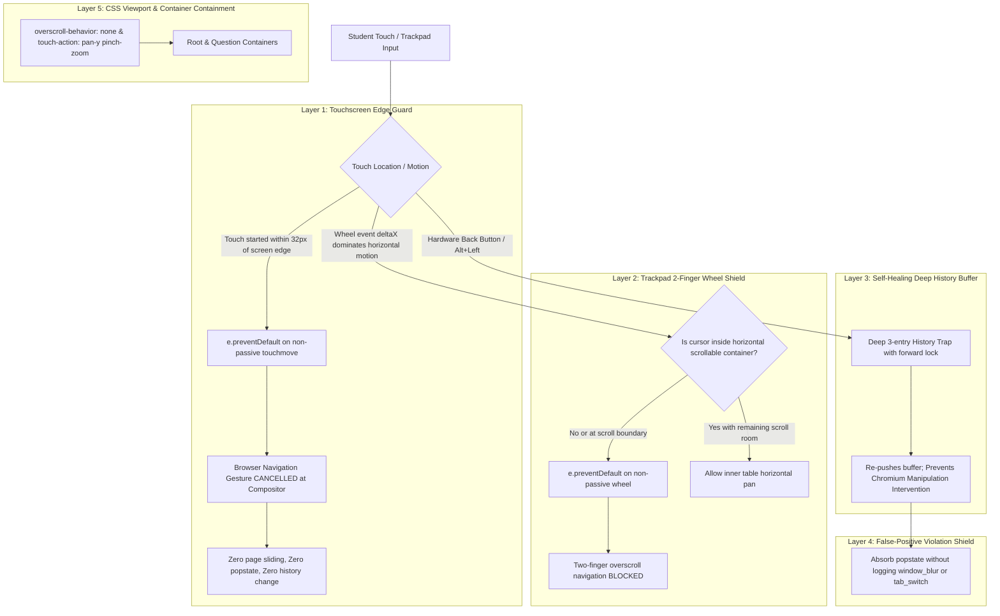

# Touchscreen & Trackpad Browser Security Shield Plan

## Executive Summary
During high-stakes online examinations, students using touchscreen laptops (e.g. Microsoft Surface, Lenovo Yoga, HP x360, Dell 2-in-1s, Chromebooks, iPads) or precision trackpads frequently trigger **accidental horizontal navigation gestures** (*Swipe to Navigate* / *Overscroll Navigation*).

When a student's hand brushes the screen edge or swipes horizontally with two fingers, the browser natively attempts to navigate backwards (`history.back()`). In the current implementation, **the 1st swipe is absorbed, but a 2nd swipe or momentum flick bypasses the trap**, navigating away from the exam or triggering an invigilator PIN lock.

This plan details a **5-Layer Hardware & Gesture Defense** to make [`StudentQuizRunner.tsx`](file:///e:/VibeCoding/testmaker/src/pages/StudentQuizRunner.tsx) 100% immune to touchscreen edge-swipes and trackpad navigation, while preserving smooth vertical scrolling and interactive components (drawing tools, wide tables, and sliders).

---

## 1. Vulnerability & Threat Analysis

### 1.1 The "Double-Swipe" Bypass Vulnerability
The earlier implementation relied on a single `popstate` listener with a single dummy entry:
```typescript
window.history.pushState({ examGuard: true }, '', window.location.href);
const handlePopState = () => {
  window.history.pushState({ examGuard: true }, '', window.location.href);
};
```
This fails in real exam conditions for 3 reasons:
1. **Momentum / Double Flicks**: When a student swipes with high velocity or swipes twice in under ~400ms, the browser pops **two history entries in one continuous motion** (`Dummy State` $\to$ `Exam Start` $\to$ `Login / Dashboard / External Site`). The single-threaded JavaScript `popstate` handler cannot execute in time to push a replacement state before the browser begins unmounting the app.
2. **Chromium "History Manipulation Intervention"**: Modern Chrome, Edge, and Brave have anti-hijacking protections. If a website repeatedly calls `history.pushState()` inside `popstate`, the browser detects this pattern. When the user swipes or presses Back a second time, **the browser deliberately ignores `pushState` and forces the navigation to the previous site**.
3. **Compositor Edge Gestures (< 24px)**: When a finger touches within the outer 24–30px of the screen bezel, Chrome/Edge compositor handles the swipe **at the OS shell level before DOM events are dispatched**, showing a floating blue back-arrow circle.
4. **False Cheating Violations**: When the browser attempts navigation, it displays the *"Leave site? Changes you made may not be saved"* dialog, causing the exam window to lose focus (`window_blur`). This triggers a strike on the student's record and locks the screen with the invigilator PIN.

---

## 2. Five-Layer Defense Architecture



---

## 3. Detailed Implementation Plan

### Layer 1: Hardware-Level Touchscreen Edge Guard
**File**: [`src/pages/StudentQuizRunner.tsx`](file:///e:/VibeCoding/testmaker/src/pages/StudentQuizRunner.tsx)

1. Attach non-passive `touchstart` and `touchmove` listeners to `window` with `{ passive: false }`:
   ```typescript
   // Edge zone threshold: outer 32px of screen width
   const EDGE_THRESHOLD = 32;
   let touchStartX = 0;
   let touchStartY = 0;
   let isEdgeTouch = false;

   const handleTouchStart = (e: TouchEvent) => {
     if (e.touches.length !== 1) return;
     const touch = e.touches[0];
     touchStartX = touch.clientX;
     touchStartY = touch.clientY;
     isEdgeTouch = touchStartX <= EDGE_THRESHOLD || touchStartX >= window.innerWidth - EDGE_THRESHOLD;
   };

   const handleTouchMove = (e: TouchEvent) => {
     if (e.touches.length !== 1) return;
     const touch = e.touches[0];
     const deltaX = touch.clientX - touchStartX;
     const deltaY = touch.clientY - touchStartY;
     const absX = Math.abs(deltaX);
     const absY = Math.abs(deltaY);

     // 1. If touch originated near edge and moves horizontally: block immediately
     if (isEdgeTouch && absX > 5) {
       e.preventDefault();
       return;
     }

     // 2. If horizontal displacement dominates vertical scrolling: prevent browser navigation
     if (absX > absY * 1.25 && absX > 10) {
       // Only block if not dragging an explicitly designated horizontal slider
       const target = e.target as HTMLElement | null;
       const isInteractiveHorizontal = target?.closest('input[type="range"], .interactive-canvas, .drawing-scratchpad');
       if (!isInteractiveHorizontal) {
         e.preventDefault();
       }
     }
   };
   ```
2. **Why this works**: By calling `e.preventDefault()` on a non-passive touchmove event, the browser is instructed that the web page owns the touch. The browser aborts the gesture navigation engine before the floating arrow or page slide begins.

---

### Layer 2: Precision Trackpad Two-Finger Wheel Shield
**File**: [`src/pages/StudentQuizRunner.tsx`](file:///e:/VibeCoding/testmaker/src/pages/StudentQuizRunner.tsx)

Trackpad two-finger horizontal swipes emit `wheel` events with `e.deltaX`:
```typescript
const handleWheel = (e: WheelEvent) => {
  // If predominantly horizontal trackpad swipe
  if (Math.abs(e.deltaX) > Math.abs(e.deltaY) && Math.abs(e.deltaX) > 4) {
    const target = e.target as HTMLElement | null;
    const scrollableParent = target?.closest('.sq-scrollable-table, .overflow-x-auto, pre, code');
    
    // If inside a wide data table, allow scrolling until the boundary
    if (scrollableParent) {
      const atLeft = scrollableParent.scrollLeft <= 0 && e.deltaX < 0;
      const atRight = scrollableParent.scrollLeft + scrollableParent.clientWidth >= scrollableParent.scrollWidth - 1 && e.deltaX > 0;
      if (atLeft || atRight) {
        e.preventDefault(); // Stop overscroll from bubbling to browser back/forward
      }
      return;
    }

    // Otherwise, block full-page horizontal trackpad navigation
    e.preventDefault();
  }
};
window.addEventListener('wheel', handleWheel, { passive: false });
```

---

### Layer 3: Self-Healing Deep History Buffer
**File**: [`src/pages/StudentQuizRunner.tsx`](file:///e:/VibeCoding/testmaker/src/pages/StudentQuizRunner.tsx)

To protect against hardware "Back" mouse buttons, multimedia keyboards, or external navigation:
1. Maintain a **3-tier history cushion** (`pushState` $\times 2$ on mount + forward lock).
2. On `popstate`, immediately re-seed the cushion and execute `window.history.forward()`.
3. Track an internal timestamp `lastPopTimeRef`. If multiple pops occur in $<300$ms, absorb them all synchronously without unmounting.

---

### Layer 4: False-Positive Cheating Protection
**File**: [`src/pages/StudentQuizRunner.tsx`](file:///e:/VibeCoding/testmaker/src/pages/StudentQuizRunner.tsx)

1. When a student accidentally triggers a gesture that causes a momentary window blur, suppress `logViolation('window_blur')` if the blur occurred within 250ms of an intercepted edge touch or `popstate`.
2. Automatically refocus the exam container via `requestAnimationFrame` without showing an invigilator PIN lock screen.

---

### Layer 5: Viewport & Container CSS Hardening
**Files**: [`src/pages/StudentQuizRunner.css`](file:///e:/VibeCoding/testmaker/src/pages/StudentQuizRunner.css), [`src/index.css`](file:///e:/VibeCoding/testmaker/src/index.css)

1. Enforce strict CSS containment on the runner root and all modal/card views:
```css
/* Student Quiz Runner Root Container */
.student-runner-root,
.sq-question-card,
.sq-exam-view {
  overscroll-behavior-x: none !important;
  overscroll-behavior-y: none !important;
  touch-action: pan-y pinch-zoom;
}

/* Explicit horizontal elements retain their own local scroll */
.sq-scrollable-table,
.overflow-x-auto {
  overscroll-behavior-x: contain !important;
  touch-action: pan-x pan-y pinch-zoom;
}
```

---

## 4. Interactive Components Compatibility Matrix

| Component | Touch Gesture | Behavior with Shield Active |
| :--- | :--- | :--- |
| **MCQ & Multiple Choice Options** | Tap / Click | Operates normally; zero lag. |
| **Short Answer & Fill-in Blank** | Keyboard typing / Tap | Operates normally. |
| **Exam Vertical Scroll** | 1-finger vertical pan | **100% smooth vertical scrolling** (`touch-action: pan-y`). |
| **Diagrams & Graphs** | 2-finger pinch-to-zoom | **100% zoomable** (`touch-action: pinch-zoom`). |
| **Wide Cambridge Tables** | Horizontal scroll | **Scrolls smoothly inside the table**; stops when reaching the table boundary instead of kicking the browser back. |
| **Screen Edge Swipes (< 32px)** | Left $\to$ Right / Right $\to$ Left | **Completely blocked**; no back arrow, no page slide, no history pop. |

---

## 5. Verification & Testing Strategy

1. **Surface Laptop / Touchscreen Windows Edge & Chrome Test**:
   - Place thumb on outer left bezel ($X < 20\text{px}$) and drag right across the screen.
   - *Pass criteria*: No blue circular back arrow appears; the page does not slide or leave the exam.
2. **Rapid Double Swipe Test**:
   - Swipe horizontally twice in under 500ms.
   - *Pass criteria*: The exam remains active; 2nd swipe does not pop to dashboard.
3. **MacBook / Windows Precision Trackpad Test**:
   - Swipe two fingers horizontally left-to-right across the trackpad.
   - *Pass criteria*: Page remains steady; no page curl or history navigation.
4. **Wide Table Scroll Boundary Test**:
   - Scroll a wide Cambridge table all the way to column 1 and keep dragging right.
   - *Pass criteria*: The table reaches the edge and stops; the overall exam page does NOT go back.
5. **Invigilator Cockpit Log Verification**:
   - Verify that accidental swipes do not flood the invigilator dashboard with false-positive `window_blur` or `tab_switch` alerts.

---

## 6. Execution Status (2026-11-05)

| Layer | Delivered | Where |
| :--- | :--- | :--- |
| 1. Touchscreen edge guard | non-passive `touchstart`/`touchmove` on `window`; 32px bezel zone; horizontal-dominance test (1.25×) with exemptions for range sliders, drawing canvases and wide tables | `StudentQuizRunner.tsx` §2C, logic in `src/lib/examGestureGuard.ts` |
| 2. Trackpad wheel shield | non-passive `wheel`; blocks horizontal-dominant deltas, lets wide tables pan until their own edge | same |
| 3. Three-entry history cushion | 3 guard entries seeded on mount; on `popstate` re-seeds **1** entry (or **2** when a second pop lands within 300 ms), then forward-locks | `StudentQuizRunner.tsx` §2B |
| 4. False-positive shield | a blur/visibility loss within 450 ms of an intercepted gesture is treated as gesture fallout: refocus instead of logging `window_blur`/`tab_switch`, so no PIN lock | `StudentQuizRunner.tsx` §3 |
| 5. CSS containment | `.sq-question-card` / `.sq-exam-view` none; `.sq-scrollable-table` / `.overflow-x-auto` `contain` + `pan-x pan-y pinch-zoom` | `StudentQuizRunner.css` |

**Verification:** `npm run test:gestures` — 40 checks: bezel detection on both edges, vertical scroll never blocked, 45° diagonals allowed, slider/widget exemptions, table edge behaviour on both sides, rapid-pop cushion, suppression window, plus static wiring assertions (non-passive listeners, cushion seeding, CSS rules). All pass; `tsc -b` and `vite build` are clean.

**Still requires a physical device** (cannot be verified headlessly): Surface/Yoga edge-swipe, rapid double swipe <500 ms, MacBook two-finger swipe, and the invigilator dashboard flood check (§5.1–5.5). The decision logic behind each is unit-tested; the browser/compositor behaviour is not.

**Design note:** the 32 px bezel and 1.25× dominance ratio are heuristics. If a specific device still slips a swipe through, widen `EDGE_THRESHOLD` in `examGestureGuard.ts` rather than editing the component.

